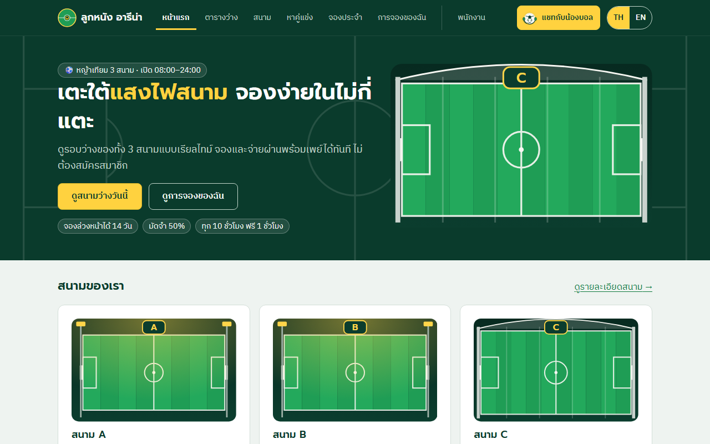
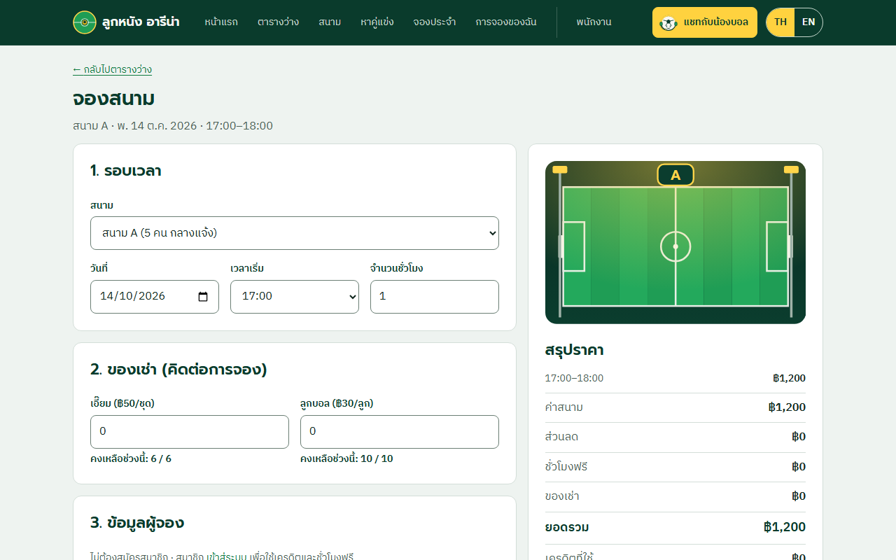
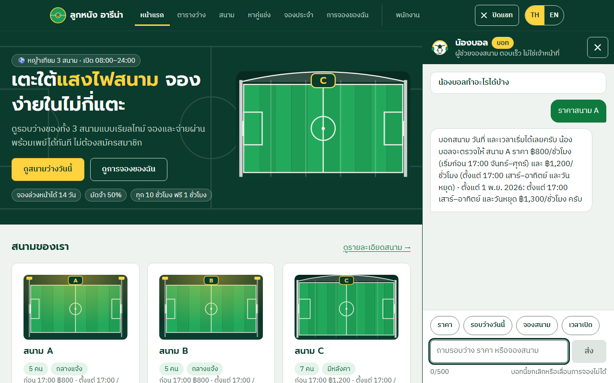
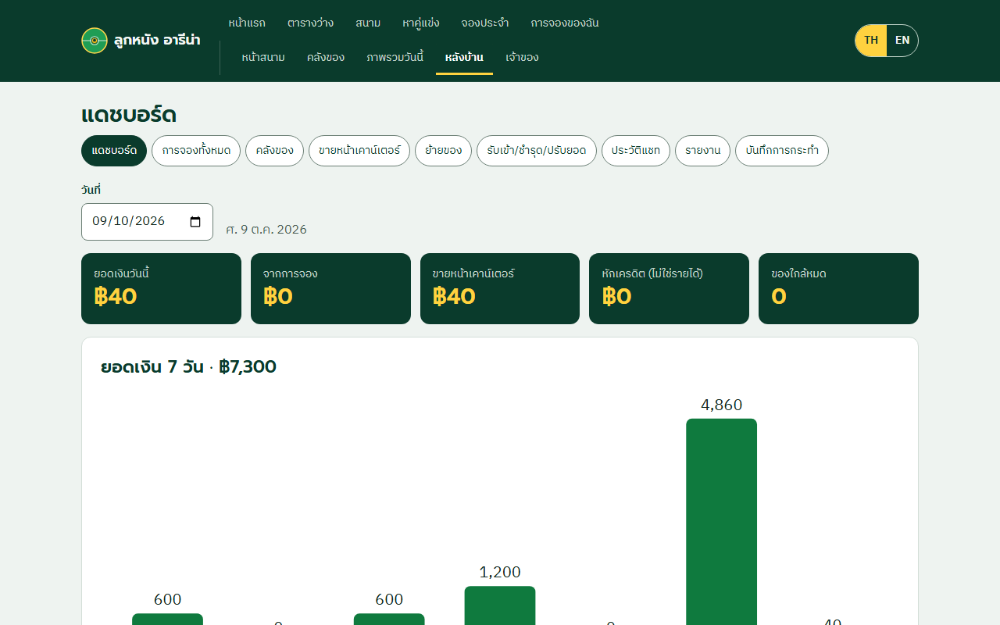

# ลูกหนัง อารีน่า — ระบบจองสนามฟุตบอลหญ้าเทียม

ระบบจองสนามฟุตบอลหญ้าเทียม 3 สนาม (A, B 5 คน · C 7 คน มีหลังคา) ครบทั้ง **หน้าลูกค้า** (จอง ชำระมัดจำ ยกเลิก เครดิต จองประจำ ทีม/คำท้า สมาชิก) · **หลังบ้าน** (พนักงาน / ผู้จัดการ / เจ้าของ: เช็กอิน รายงาน บันทึกการกระทำ) · **คลังของ** (ขาย ย้าย รับเข้า ปรับยอด เตือนของต่ำ) และแชทบอท **"น้องบอล"** (โหมด `mock` ไม่ออก network หรือ `ai`) · Next.js + PostgreSQL แยก Docker 2 โปรเจกต์ · ทำโดยเอา **ทุกบทเรียนของ [`Teaching_CWN2026`](https://github.com/Tuchsanai/Teaching_CWN2026)** มาใช้กับงานจริง ตั้งแต่ฟังร้าน เขียน requirement สร้างเว็บ พิสูจน์ด้วย Playwright จนรับมอบแล้วทำคำขอเปลี่ยนแปลง CR-01…06 — ตารางว่าบทไหนทำอะไรที่ไหนอยู่ใน [`docs/11-INSTRUCTOR-MAP.md`](docs/11-INSTRUCTOR-MAP.md)

## หน้าตา

| หน้าแรก | จองสนาม |
|---|---|
|  |  |
| **แชทน้องบอล** | **แดชบอร์ดเจ้าของ** |
|  |  |

(ถ่ายจากเว็บที่รันจริงด้วย `tools/ui-shots.mjs` · ตัวเลขในแดชบอร์ดเป็นข้อมูลทดลองที่ล็อก "วันนี้" = 9 ต.ค. 2569)

## รันด้วยคำสั่งเดียว (ต้องมี Docker Desktop)

```bash
docker compose up -d --build      # หรือ  ./start.sh  (mac/Linux/Git Bash)  ·  .\start.ps1  (Windows)
```

รอ healthy แล้วเปิด <http://localhost:3000> · บัญชีทดลอง (พนักงาน / ผู้จัดการ / เจ้าของ / สมาชิก) อยู่ใน [`docs/TEST-DATA.md`](docs/TEST-DATA.md) และ [`web/SPEC.md`](web/SPEC.md) · Portal ตรวจงาน (เอกสาร test case ผลรัน) ที่ <http://localhost:3000/project> · รายละเอียด สำรอง/กู้คืน/migration ถอยกลับ: [`docs/RUNBOOK.md`](docs/RUNBOOK.md) (คำสั่งเดียว = ข้อ 10)

**เครื่องจริง (production):** ตั้งรหัสผ่าน DB ใหม่ · `SESSION_SECRET` สุ่ม ≥ 32 ตัว · **`ALLOW_TEST_RESET=0`** (ค่าเดโมเปิดช่อง reset ข้อมูลไว้) · รหัสผ่านเดโมอยู่ใน git ห้ามใช้กับข้อมูลจริง · ห้าม `docker compose down -v`

## รัน test (ต้องมี Node.js 20+ และเปิดเว็บไว้แล้ว)

| ชุด | คำสั่ง |
|---|---|
| e2e 3 เบราว์เซอร์ + serial + perf (~11–15 นาที · จบแล้วสร้าง `e2e/index.html`) | `cd e2e && npm ci && npm run browsers` (ครั้งแรก) แล้ว `node run-all.mjs` |
| golden master (ต่าง = exit 1) | `node tests/golden/check.mjs` |
| unit | `cd web && npm test` |
| smoke (อ่านอย่างเดียว) | `node tests/smoke.mjs` |
| a11y (axe) | `cd e2e && npx playwright test tests/my/a11y.spec.ts --project=chromium --no-deps` (`A11Y_GATE=1` = ล้มถ้ามี serious/critical) |
| MCP server ของสนาม | `node tools/mcp-football/test-client.mjs` |
| ตรวจลิงก์เอกสาร | `node tools/check-links.mjs` |

test เดิมห้ามแก้ — ถ้าค่าที่คาดหวังต้องเปลี่ยนตาม CR ต้องมีแถวใน [`ORACLE-CHANGES.md`](ORACLE-CHANGES.md) พร้อมผู้อนุมัติ · กติกาทีมดูแลระบบ: [`CLAUDE.md`](CLAUDE.md)

## ผลทดสอบ

รอบเต็มบน `main` commit `733d0a7` (`BUG_MODE=0`, schema 009) · แหล่ง: [`e2e/index.html`](e2e/index.html) (รายงาน HTML — **ดาวน์โหลดแล้วเปิดในเครื่อง**) · [`legacy/REGRESSION-REPORT.md`](legacy/REGRESSION-REPORT.md) · [`docs/ui/PROGRESS.md`](docs/ui/PROGRESS.md) · test case 128 ข้อพร้อมเฉลย: [`docs/TEST-CASES.md`](docs/TEST-CASES.md)

| ชุด | ผล |
|---|---|
| e2e ทั้งรอบ | **491 ผ่าน · 2 ล้ม** (webkit `TC-BOOK-01`, `TC-STAFF-06` — flaky ที่รู้ รันซ้ำผ่าน) |
| chromium · firefox · webkit | **128/128** · **128/128** · **126/128** |
| unit · smoke | **159** · **10/10** |
| axe serious/critical | **0** (ก่อนปรับหน้าตา serious 32) |
| golden master (quote · side · quote-nov) | **261 · 15 · 132** |
| portal-check (commit `1d2e794`) | **1261** |
| MCP test-client | **13/13** |

## อาจารย์ตรวจอะไรได้ที่ไหน

คะแนนรูบริก 4 บท (03–06) ตัวเอง **74/80** → [`docs/RUBRIC-SELF-CHECK.md`](docs/RUBRIC-SELF-CHECK.md)

| บทเรียน | หลักฐาน |
|---|---|
| `00_setup` | [`docs/00-ENVIRONMENT.md`](docs/00-ENVIRONMENT.md) · แชทบอท `web/lib/chat/` + `web/mock-llm/` · รายงานแชท `e2e/test-report/CHATBOT-REPORT.md` |
| `00_tester` 01 ติดตั้ง Playwright · 02 เทสต์ตามแผน | `e2e/` (`playwright.config.ts`, `run-all.mjs`, `index.html`) · LAB 9 = `CLAUDE.md` + `e2e/tests/cr/` |
| `00_tester` 03 แผนจากการสำรวจ | [`docs/EXPLORATION.md`](docs/EXPLORATION.md) · [`docs/09-TEST-PLAN.md`](docs/09-TEST-PLAN.md) · [`docs/PLAN-REVIEW.md`](docs/PLAN-REVIEW.md) · [`docs/TEST-CASES.md`](docs/TEST-CASES.md) |
| `00_tester` 04 สัมภาษณ์ → เว็บ → แผน | [`docs/01-INTERVIEW.md`](docs/01-INTERVIEW.md) → [`docs/04-REQUIREMENTS.md`](docs/04-REQUIREMENTS.md) → [`docs/TEST-DATA.md`](docs/TEST-DATA.md) → `web/` + `db/` · [`docs/BUG-HUNT.md`](docs/BUG-HUNT.md) |
| `00_tester` 05 รับช่วงระบบเดิม (REA) | [`legacy/`](legacy) (SYSTEM-MAP · HANDOVER-CHECK · BASELINE · MUTANTS · REA-COMPARE) · `tests/golden/` |
| `00_tester` 06 คำขอเปลี่ยนแปลง | [`docs/handover/`](docs/handover) (CR-01…06 · REGISTER · RELEASE-NOTES · UAT-CHECKLIST · KNOWN-ISSUES) · [`docs/impact/`](docs/impact) |
| `01_Basic_AI_WORFLOW` Loop · Graph · Dynamic | [`docs/trace/`](docs/trace) (`phase2-loop.md` · `phase3-graph.md` · `dynamic/` แผน v1→v5 + execution-table) |
| `02_MCP` | [`docs/mcp/MCP-REPORT.md`](docs/mcp/MCP-REPORT.md) · MCP server ของสนาม [`tools/mcp-football/`](tools/mcp-football) · `docs/mcp/excalidraw/` |
| ส่งมอบ/ทำต่อ | [`docs/handover/`](docs/handover) · [`docs/process/HANDOFF.md`](docs/process/HANDOFF.md) · [`docs/process/PLAN.md`](docs/process/PLAN.md) |

## โครงสร้างโฟลเดอร์ (ราก)

อธิบายเหตุผลและการย้ายไฟล์: [`docs/REPO-LAYOUT.md`](docs/REPO-LAYOUT.md)

| ที่ | คืออะไร |
|---|---|
| `web/` | เว็บ Next.js + API + unit test + แชทบอท |
| `db/` | PostgreSQL: migration 001–009 (มี `.down.sql`) · seed · compose แยก |
| `e2e/` | Playwright e2e + รายงาน (`index.html`) |
| `tests/` · `tools/` · `scripts/` | golden/smoke · เครื่องมือ (MCP server, ถ่ายภาพ, ตรวจลิงก์, สร้างกราฟงาน) · migrate/backup/restore |
| `docs/` | requirement → SRS/SAD → แผนทดสอบ · `handover/` · `process/` · `trace/` · `mcp/` · `workflow/` · `evidence/` |
| `legacy/` · `exploration/` | เอกสารรับช่วงระบบเดิม (บท 05) · ผลสำรวจเว็บ |
| `compose.yaml` · `start.sh` · `start.ps1` | รันคำสั่งเดียว |
| `CLAUDE.md` · `ORACLE-CHANGES.md` | กติกาทีมดูแลระบบ · ทะเบียนเปลี่ยนค่าที่คาดหวังของเทสต์ |

## ข้อจำกัด / ที่ยังไม่ได้ทำ (พูดตรง ๆ)

- **หน้าตา S3 (หน้าลูกค้าใหม่) และ S4 (หลังบ้านใหม่)** จอดไว้ที่ branch `ui-final` (อยู่ในเครื่อง ยังไม่ merge, ยังไม่ได้ตรวจรอบเต็ม) — `main` มี S0–S2b ([`docs/ui/PROGRESS.md`](docs/ui/PROGRESS.md))
- **webkit ล้ม 2 ข้อที่ flaky** (`TC-BOOK-01`, `TC-STAFF-06`) ยังไม่ได้แก้ให้นิ่ง · `TC-SERIES-04` พิสูจน์ผ่านหน้าเว็บไม่ได้ ใช้ unit E75 แทน
- **น้องบอลยังไม่เคยทดสอบกับโมเดลจริง** (ผ่านเฉพาะ `mock` และ mock-llm) · ด่าน MCP `claude -p` เรียก tool จริงติดล็อกอินหมดอายุ 401
- **ทดสอบรั้ว** `.claude/settings.json` ในเซสชันใหม่ (`legacy/FENCE-TEST.md`) ยังค้าง
- **UAT ร้านยังไม่เซ็น** — ทีมเดินใบตรวจรับแล้วแต่ร้านยังไม่ได้เดินเอง ([`docs/handover/UAT-CHECKLIST.md`](docs/handover/UAT-CHECKLIST.md))
- ปัญหาที่รู้และยังไม่แก้ (K1–K14: เช่น เว็บต่อ DB ด้วยสิทธิ์ superuser · ตั้งราคาในหน้าเว็บไม่ได้): [`docs/handover/KNOWN-ISSUES.md`](docs/handover/KNOWN-ISSUES.md)
- ยังไม่ได้ push ส่วนงานล่าสุดขึ้น `origin` (ต้องให้เจ้าของโปรเจกต์ยืนยันก่อน) — สถานะละเอียด [`docs/process/HANDOFF.md`](docs/process/HANDOFF.md) ข้อ 3

## Workflow ของงานนี้


- แตกงานทั้งโครงการเป็นกราฟ (DAG) ตามบทของอาจารย์ แล้วคำนวณ **rank(j) = c_j + max rank(งานที่ต้องรอ j)** · งานท้ายสุด rank = c
- **cost (c)** = ชั่วโมงทำงานจริงจาก `git log` (นับระยะห่างจาก commit ก่อนหน้า ตัดช่องเกิน 2 ชม. ที่ 2 ชม. ขั้นต่ำ 0.25) · งานก่อน 10 ต.ค. ประมาณจากแผน (กรอบเส้นประ)
- **สีตามผู้ทำ:** Opus วางแผน/รีวิว · Sonnet ลงมือทำ · ผู้ใช้ตัดสินในฐานร้าน/ผู้อนุมัติ (ป้าย ✓) · ผู้ตรวจของทุกงานคือเทสต์ (unit · golden · e2e · MCP)
- **สายวิกฤต** 20 งานจาก 26 รวม **42.05 ชม.** (P0-3 → … → T2 → T2e)
- รายละเอียด วิธีสร้างภาพใหม่ และข้อจำกัดของการนับ: [`docs/workflow/README.md`](docs/workflow/README.md)
