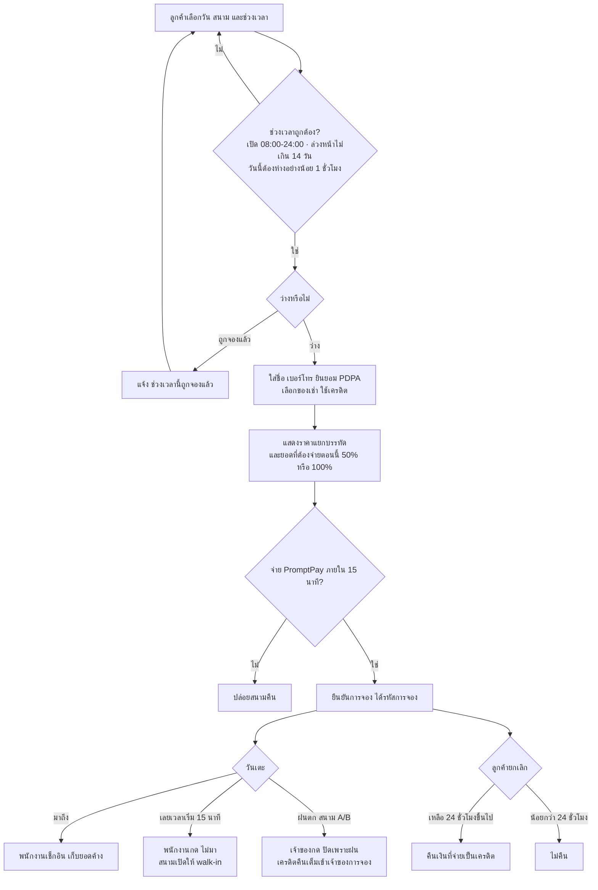

# 02 · Business Analysis — ลูกหนัง อารีน่า

แหล่งข้อมูลเดียว: [`01-INTERVIEW.md`](01-INTERVIEW.md) (v2, 2026-10-09) · ตัวเลขทุกตัวในเอกสารนี้มาจากบทสัมภาษณ์ ถ้าคำนวณจะแสดงที่มา

## 1. เป้าหมายและขอบเขต

**เป้าหมายธุรกิจ:** ให้ลูกค้าจองและจ่ายเงินสนามฟุตบอลหญ้าเทียมได้เองผ่านเว็บ ลดการทักถามเจ้าของ (S22) ลดการเบี้ยวนัด (S13, S17) และให้หน้าร้านทำงานจากข้อมูลเดียวกัน (S27–S30)

| อยู่ในขอบเขต | ไม่อยู่ในขอบเขต |
|---|---|
| จอง ราคา จ่ายมัดจำ/จ่ายเต็ม (จำลอง PromptPay) ยกเลิก เครดิต | การรับเงินจริงผ่านธนาคาร |
| จองประจำ ของเช่า สมาชิกสะสมชั่วโมง หารค่าสนาม หาทีมคู่แข่ง | ระบบบัญชี/ภาษี |
| หน้าพนักงาน (เช็กอิน ไม่มา คืนของ) หน้าเจ้าของ/ผู้จัดการ (ปิดเพราะฝน วันหยุด ภาพรวมวันนี้) | แอปมือถือแยก (ใช้เว็บบนมือถือ) |
| ภาษาไทย / อังกฤษ · รูปสนาม | |

## 2. ผู้มีส่วนได้ส่วนเสีย (Stakeholders)

| ผู้เกี่ยวข้อง | บทบาทต่อระบบ | สิ่งที่ต้องการหลัก | คำพูดต้นทาง |
|---|---|---|---|
| คุณเอก (เจ้าของ) | ตั้งกฎ ราคา วันหยุด ปิดสนามเพราะฝน | ลูกค้าจองเอง กฎถูกบังคับอัตโนมัติ | S01–S24 |
| คุณฝ้าย (ผู้จัดการ) | ดูภาพรวมรายวัน | เห็นสนามว่าง ใครจ่ายแล้ว ของเช่าคงเหลือ | S25–S27 |
| น้องบอล (พนักงานหน้าสนาม) | เช็กอิน เก็บเงินที่ค้าง บันทึกไม่มา คืนของ | รู้ยอดค้าง และของเช่าที่เหลือ | S28–S30 |
| คุณต้น (กัปตันทีมบริษัท) | ลูกค้าประจำ | จองยาวรายสัปดาห์ หารค่าสนาม ใช้เครดิต | S31–S33 |
| น้องมิว (นักศึกษา) | ลูกค้า งบน้อย ใช้มือถือ | หาช่วงถูก เห็นสนามว่างเร็ว รู้แต้มสะสม | S34–S36 |
| คุณโจ้ (ทีมขาดคู่) | ลูกค้า | หาทีมคู่แข่ง ได้เครดิตคืนส่วนที่ทีมคู่แข่งจ่าย | S37–S39 |
| คุณแนน (ลูกค้าครั้งแรก) | ลูกค้าขาจร | จองโดยไม่สมัครยาว เห็นราคาแยกบรรทัด เลื่อนวันเอง | S40–S42 |
| Mr. Daniel (ชาวต่างชาติ) | ลูกค้า | เว็บภาษาอังกฤษ ดูรูปสนาม | S43–S44 |

## 3. รายการคำพูดต้นทาง (S-xx)

ทุกข้อสรุปจากบทสัมภาษณ์ ใช้อ้างอิงใน User Story และ Requirement

| รหัส | ผู้พูด | ใจความ |
|---|---|---|
| S01 | คุณเอก | มี 3 สนาม: A และ B สนาม 5 คนกลางแจ้ง · C สนาม 7 คนมีหลังคา |
| S02 | คุณเอก | เปิดทุกวัน 08:00–24:00 จองเป็นชั่วโมง เริ่มตรงชั่วโมงเท่านั้น รอบสุดท้ายเริ่ม 23:00 |
| S03 | คุณเอก | จองครั้งหนึ่งตั้งแต่ 1 ชั่วโมงขึ้นไป ต่อเนื่องในสนามเดียว ไม่จำกัดจำนวนชั่วโมง ต้องจบไม่เกิน 24:00 |
| S04 | คุณเอก | จองล่วงหน้าได้ไม่เกิน 14 วัน · จองวันนี้ได้ถ้าเวลาเริ่มห่างจากตอนนี้อย่างน้อย 1 ชั่วโมง |
| S05 | คุณเอก | สนามเดียวกันเวลาเดียวกันจองซ้อนไม่ได้ ขึ้นข้อความ "ช่วงเวลานี้ถูกจองแล้ว" |
| S06 | คุณเอก | สนาม 5 คน ฿800/ชม. ถ้าเริ่มก่อน 17:00 · ฿1,200/ชม. ถ้าเริ่มตั้งแต่ 17:00 (รวมค่าไฟ) |
| S07 | คุณเอก | สนาม 7 คน ฿1,200/ชม. ก่อน 17:00 · ฿1,800/ชม. ตั้งแต่ 17:00 |
| S08 | คุณเอก | เสาร์–อาทิตย์ และวันหยุดนักขัตฤกษ์ คิดราคาเย็นทั้งวัน |
| S09 | คุณเอก | เจ้าของใส่วันหยุดนักขัตฤกษ์เองในระบบ ช่วงนี้มี 13 ต.ค., 23 ต.ค., 5 ธ.ค., 10 ธ.ค., 31 ธ.ค. 2569 |
| S10 | คุณเอก | จองคร่อมเวลา คิดราคาแยกทีละชั่วโมง (เช่น 16:00 ราคากลางวัน, 17:00 ราคาเย็น) |
| S11 | คุณเอก | ต้องจ่ายผ่าน PromptPay ภายใน 15 นาที ไม่งั้นระบบปล่อยสนามคืน |
| S12 | คุณเอก | ปกติจ่ายมัดจำ 50% ที่เหลือจ่ายหน้าสนาม |
| S13 | คุณเอก | คืนวันศุกร์และวันเสาร์ ช่วงที่เริ่มตั้งแต่ 17:00 ต้องจ่ายเต็ม 100% |
| S14 | คุณเอก | ยกเลิกเองได้ถ้าเหลือเวลาก่อนเตะ 24 ชั่วโมงขึ้นไป คืนเงินที่จ่ายเป็นเครดิต (ไม่คืนเงินสด) ต่ำกว่านั้นไม่คืน |
| S15 | คุณเอก | ฝนตก สนามกลางแจ้งเตะไม่ได้ เจ้าของกด "ปิดเพราะฝน" ลูกค้าได้เครดิตคืนเต็มที่จ่าย |
| S16 | คุณเอก | เครดิตทุกกรณีเข้าบัญชีเจ้าของการจองคนเดียว ร้านไม่แบ่งเครดิตให้ลูกทีม |
| S17 | คุณเอก | ไม่มา (no-show) 2 ครั้งภายใน 30 วัน ห้ามจองออนไลน์ 30 วัน |
| S18 | คุณเอก | จองประจำวันเดิมเวลาเดิมทุกสัปดาห์ได้ 4–12 สัปดาห์ · ตั้งแต่ 8 สัปดาห์ขึ้นไปลด 10% |
| S19 | คุณเอก | จองประจำแล้วชนกับคนอื่น ให้บอกว่าชนสัปดาห์ไหน แล้วให้ลูกค้าเลือกจองเฉพาะสัปดาห์ที่ว่าง |
| S20 | คุณเอก | เสื้อเอี๊ยมชุดละ 10 ตัว ฿50 (มี 6 ชุด) · ลูกบอลลูกละ ฿30 (มี 10 ลูก) · เช่าต่อการจอง 1 ครั้ง ของในช่วงเวลาเดียวกันมีจำกัดตามนี้ |
| S21 | คุณเอก | สมาชิกสะสมชั่วโมงที่จ่ายเต็มแล้ว ทุก 10 ชั่วโมงได้ฟรี 1 ชั่วโมง ใช้ได้เฉพาะก่อน 17:00 วันจันทร์–ศุกร์ |
| S22 | คุณเอก | อยากให้ลูกค้าหาทีมมาเตะด้วยในเว็บ ไม่ต้องทักเจ้าของทุกครั้ง |
| S23 | คุณเอก | ทีมที่รับคำท้าจ่ายครึ่งหนึ่งของค่าสนามให้ร้าน ร้านคืนส่วนนั้นให้เจ้าของการจองเป็นเครดิต |
| S24 | คุณเอก | ต้องเก็บเบอร์โทรลูกค้า และขอความยินยอมตาม PDPA |
| S25 | คุณฝ้าย | คืนศุกร์และคืนเสาร์ (เริ่มตั้งแต่ 17:00) จ่ายเต็มอย่างเดียว ตรงกับที่ตกลงกับคุณเอก |
| S26 | คุณฝ้าย | วันหยุดนักขัตฤกษ์คิดราคาแบบเสาร์–อาทิตย์ คุณเอกเป็นคนใส่รายการวันหยุด |
| S27 | คุณฝ้าย | อยากเห็นหน้ารวมวันนี้: สนามว่าง/ไม่ว่าง ใครจ่ายแล้ว ใครค้างจ่าย ของเช่าเหลือเท่าไร |
| S28 | น้องบอล | เช็กอินด้วยรหัสการจอง เห็นว่าจ่ายครบหรือยัง ต้องเก็บเงินค้างเท่าไร |
| S29 | น้องบอล | เลยเวลาเริ่ม 15 นาทียังไม่มา กด "ไม่มา" ได้ แล้วสนามเปิดให้คนมาเตะหน้าสนาม |
| S30 | น้องบอล | ตอนคืนของเช่า กดคืนในระบบ จะได้รู้ว่ายังมีเอี๊ยมเหลือให้รอบถัดไปไหม |
| S31 | คุณต้น | เตะทุกวันพุธ 19:00–21:00 สนาม A อยากจองยาว 10 สัปดาห์ และรู้ราคาหลังลดก่อนจ่าย |
| S32 | คุณต้น | อยากส่งลิงก์ให้ลูกทีมหารค่าสนาม และเห็นว่าใครโอนแล้ว ใครยังไม่โอน |
| S33 | คุณต้น | อยากเห็นยอดเครดิตของตัวเอง และใช้หักตอนจองครั้งหน้าได้ |
| S34 | น้องมิว | อยากเห็นช่วงที่ถูกที่สุดก่อน กรองดูเฉพาะช่วงกลางวันได้ |
| S35 | น้องมิว | จองจากมือถือ อยากรู้ว่าวันนี้สนามไหนว่าง ภายในไม่เกิน 3 แตะ |
| S36 | น้องมิว | อยากรู้ว่าอีกกี่ชั่วโมงจะได้ฟรี |
| S37 | คุณโจ้ | จองสนาม C ไว้แต่คู่แข่งยกเลิก อยากประกาศหาทีมมาเตะในช่วงที่จองไว้ |
| S38 | คุณโจ้ | พอมีทีมรับคำท้าและจ่ายครึ่งหนึ่งแล้ว อยากเห็นว่าเครดิตเข้าบัญชีเท่าไร |
| S39 | คุณโจ้ | อยากเลือกระดับทีมได้ (มือใหม่ / กลาง / เก่ง) |
| S40 | คุณแนน | ไม่อยากสมัครสมาชิกยาว ใส่แค่ชื่อกับเบอร์โทรแล้วจองได้ |
| S41 | คุณแนน | อยากเห็นราคารวมแยกบรรทัดก่อนกดจ่าย (ค่าสนาม ของเช่า ส่วนลด เครดิต) |
| S42 | คุณแนน | จองผิดวัน อยากเลื่อนวันเองถ้ายังเหลือเวลาเกิน 24 ชั่วโมง |
| S43 | Mr. Daniel | อ่านไทยไม่ออก อยากให้มีเว็บภาษาอังกฤษ |
| S44 | Mr. Daniel | อยากดูรูปสนามก่อนจอง |
| S45 | คุณเอก | อยากมีแชทบอทในเว็บตอบแทนได้ทั้งวัน ชื่อ "น้องบอล" พูดสุภาพ ลงท้าย ครับ |
| S46 | คุณเอก | บอทตอบตามข้อมูลจริงในระบบเท่านั้น ห้ามแต่งราคาหรือโปร ไม่รู้ให้บอกโทร 02-345-6789 หรือ LINE @lookhnang |
| S47 | คุณเอก | ถามว่าว่างไหม บอทต้องดูตารางจริง · ถามราคา ต้องคิดแบบเดียวกับหน้าเว็บ |
| S48 | คุณเอก | จองผ่านแชท: บอทถามให้ครบ สนาม วัน เวลา กี่ชั่วโมง ชื่อ เบอร์ ยินยอม PDPA แล้วสร้างการจองและส่งลิงก์จ่ายเงิน (ยังต้องจ่ายใน 15 นาที) |
| S49 | คุณเอก | บอทยกเลิกหรือเลื่อนการจองแทนลูกค้าไม่ได้ ให้บอกวิธีทำในหน้าการจองของฉัน |
| S50 | คุณเอก | ถามเรื่องที่ไม่ใช่ร้านให้ปฏิเสธสุภาพแล้วชวนกลับมาเรื่องสนาม |
| S51 | คุณเอก | ลูกค้าพิมพ์อังกฤษ ตอบอังกฤษ · คุยต่อเนื่องได้ จำสิ่งที่คุยในแชทเดียวกัน |
| S52 | คุณเอก | อยากย้อนดูประวัติแชทว่าลูกค้าถามอะไรบ่อย |
| S53 | คุณเอก | อยากเห็นยอดเงินวันนี้กับ 7 วันล่าสุดเป็นกราฟ · ชั่วโมงที่คนจองเยอะ · สนามไหนเต็มกี่เปอร์เซ็นต์ |
| S54 | คุณเอก | อยากเห็นการจองทั้งหมด ค้นด้วยรหัส เบอร์ วัน · เห็นว่าสถานะเปลี่ยนเมื่อไร ใครกด |
| S55 | คุณเอก | หน้ารายงานเลือกช่วงวันเองได้ ครั้งละไม่เกิน 3 เดือน โหลดเป็นไฟล์เปิดใน Excel ภาษาไทยไม่เพี้ยน |
| S56 | คุณเอก | รายงานมี: จำนวนการจองแยกสถานะ · ยอดเงินแยกช่องทาง · ส่วนลดจองประจำ · ชั่วโมงฟรี · ค่าของเช่า · ยอดขายหน้าเคาน์เตอร์ · จำนวนไม่มา · ชั่วโมงที่ใช้แต่ละสนาม |
| S57 | คุณเอก | รายงานนี้เจ้าของดูได้คนเดียว |
| S58 | คุณเอก | ข้อมูลลูกค้ากับการจองห้ามหาย ต้องสำรองได้และกู้คืนได้จริง |
| S59 | คุณเอก | ใครกดไม่มา ใครปรับสต็อก ใครปิดสนาม ต้องย้อนดูได้ว่าใครทำ เมื่อไร |
| S60 | คุณเอก | เพิ่มอะไรในระบบทีหลัง ข้อมูลเก่าต้องอยู่ครบ |
| S61 | คุณฝ้าย | อยากมีคลังของ บอกว่าของแต่ละอย่างเหลือเท่าไร อยู่ที่ไหน |
| S62 | คุณฝ้าย | ของอยู่ 2 ที่: ห้องเก็บของ กับ เคาน์เตอร์ · ย้ายของต้องบันทึก |
| S63 | คุณฝ้าย | ของแต่ละอย่างตั้งจุดสั่งซื้อซ้ำได้ ต่ำกว่าเมื่อไรขึ้นเตือนในหลังบ้าน |
| S64 | คุณฝ้าย | ของเข้า-ออกทุกครั้งมีประวัติ: รับเข้า ขาย ย้าย ชำรุด ปรับยอดหลังนับจริง (ปรับยอดต้องใส่เหตุผล) |
| S65 | คุณฝ้าย | ของห้ามติดลบ ขายเกินที่มีไม่ได้ |
| S66 | น้องบอล | ลูกค้าซื้อน้ำที่เคาน์เตอร์ อยากกดขายในระบบเร็ว ๆ ให้ของที่เคาน์เตอร์ลดเอง |
| S67 | น้องบอล | ของที่เคาน์เตอร์หมด ไปหยิบจากห้องเก็บของแล้วกด "ย้าย" ในระบบ |
| S68 | คุณแนน | ตอนดึกอยากถามบอทว่าพรุ่งนี้เย็นสนาม A ว่างไหม ราคาเท่าไร แล้วจองในแชทเลย |
| S69 | น้องมิว | ถามบอทว่าช่วงไหนถูกสุด แล้วถามต่อ "ถ้าเอาช่วงนั้น 2 ชั่วโมงล่ะ" บอทต้องเข้าใจว่าหมายถึงช่วงที่เพิ่งบอก |
| S70 | Mr. Daniel | อยากถามบอทเป็นภาษาอังกฤษว่าสนาม C มีหลังคาไหม และคืนวันเสาร์ราคาเท่าไร |
| S71 | คุณต้น | อยากดูสถานะการจองเป็นขั้น: จองแล้ว → จ่ายแล้ว → เช็กอิน → จบ |

## 4. กระบวนการปัจจุบัน (As-Is)

บทสัมภาษณ์**ไม่ได้เล่าว่าตอนนี้รับจองอย่างไร** หลักฐานที่มีมีแค่:
- ลูกค้าต้อง "ทัก" เจ้าของเพื่อหาทีมคู่แข่ง (S22) → ตอนนี้การติดต่อผ่านเจ้าของโดยตรง
- หน้าสนามมีพนักงานรับลูกค้าและเก็บเงิน (S28)

รายละเอียดอื่น (ช่องทางจองปัจจุบัน วิธีจดตาราง วิธีรับเงิน) ยังไม่มีข้อมูล → เก็บเป็นคำถาม Q-01 ไม่วาด As-Is เกินหลักฐาน

## 5. กระบวนการที่ต้องการ (To-Be) — จองหนึ่งครั้ง

## 6. Pain point → ความสามารถที่ต้องมี

| Pain point (ใครบอก) | ความสามารถที่ต้องมี | คำพูดต้นทาง |
|---|---|---|
| ลูกค้าต้องทักเจ้าของเพื่อหาทีม (คุณเอก) | ประกาศหาทีมคู่แข่งในเว็บ + ระดับทีม | S22, S37, S39 |
| คืนศุกร์–เสาร์คนเบี้ยวบ่อย (คุณเอก, คุณฝ้าย) | บังคับจ่ายเต็มช่วงนั้น · บันทึกไม่มาและจำกัดการจอง | S13, S25, S17, S29 |
| ไม่รู้ภาพรวมรายวัน (คุณฝ้าย) | หน้าภาพรวมวันนี้ | S27 |
| หน้าสนามไม่รู้ยอดค้างและของเช่าคงเหลือ (น้องบอล) | เช็กอินด้วยรหัส แสดงยอดค้าง · คืนของเช่า | S28, S30 |
| หารค่าสนามในทีมยุ่ง (คุณต้น) | ลิงก์หารค่าสนาม + สถานะรายคน | S32 |
| ไม่รู้ราคาจริงก่อนจ่าย / กลัวโดนหักเงิน (คุณต้น, คุณแนน) | สรุปราคาแยกบรรทัดก่อนจ่าย | S31, S41 |
| งบน้อย หาช่วงถูกยาก (น้องมิว) | เรียง/กรองตามราคาและช่วงกลางวัน | S34 |
| อ่านไทยไม่ออก (Mr. Daniel) | สลับภาษาอังกฤษ + รูปสนาม | S43, S44 |

## 7. Gap analysis

| ด้าน | ตอนนี้ (หลักฐาน) | ที่ต้องการ | ช่องว่าง |
|---|---|---|---|
| ช่องทางจอง | ไม่มีข้อมูล (Q-01) | ลูกค้าจองและจ่ายเองผ่านเว็บ | ต้องสร้างระบบจองทั้งหมด |
| การบังคับกฎ | ไม่มีข้อมูล | ราคา มัดจำ ยกเลิก no-show คำนวณอัตโนมัติ | กฎ S02–S21 ต้องอยู่ในระบบ |
| ข้อมูลหน้าร้าน | พนักงานรับเงินหน้าสนาม (S28) | เห็นการจอง ยอดค้าง ของเช่าจากข้อมูลเดียวกัน | หน้าพนักงาน/ผู้จัดการ |
| การหาคู่แข่ง | ทักเจ้าของ (S22) | ประกาศในเว็บ | ฟีเจอร์หาคู่แข่ง |

## 8. คำถามที่ยังไม่ชัด (ต้องถามร้าน)

| รหัส | คำถาม | เกี่ยวกับ |
|---|---|---|
| Q-01 | ตอนนี้รับจองและรับเงินด้วยช่องทางใด จดตารางที่ไหน (ใช้ทำ As-Is และย้ายข้อมูลการจองเดิม) | S22, S28 |
| Q-02 | จองประจำ 10 สัปดาห์ เกินเพดานจองล่วงหน้า 14 วัน — เพดาน 14 วันใช้กับการจองประจำด้วยหรือไม่ | S04, S18, S31 |
| Q-03 | "ภายใน 15 นาที" — จ่ายตอนครบ 15 นาทีพอดีนับว่าทันหรือไม่ | S11 |
| Q-04 | จองประจำ: จ่าย 50%/100% ของทุกสัปดาห์ตอนจอง หรือจ่ายทีละสัปดาห์ | S12, S13, S18 |
| Q-05 | ส่วนลด 10% ของจองประจำ คิดเฉพาะค่าสนาม หรือรวมของเช่า | S18, S20 |
| Q-06 | เลื่อนวันเอง: เจ้าของไม่ได้กำหนดกฎ — ใช้เงื่อนไขเดียวกับยกเลิก (24 ชั่วโมงขึ้นไป) หรือ "เกิน 24 ชั่วโมง" ตามที่ลูกค้าพูด, เลื่อนได้กี่ครั้ง, ราคาต่างกันทำอย่างไร | S14, S42 |
| Q-07 | ลูกค้าที่จองด้วยชื่อ+เบอร์โดยไม่สมัคร: เครดิต ชั่วโมงสะสม และประวัติไม่มา ผูกกับเบอร์โทรหรือไม่ | S16, S17, S21, S40 |
| Q-08 | ชั่วโมงสะสม: นับชั่วโมงที่ได้ส่วนลดจองประจำ หรือชั่วโมงฟรี ด้วยหรือไม่ ("จ่ายเต็มแล้ว" หมายถึงอะไร) | S18, S21 |
| Q-09 | ลิงก์หารค่าสนาม: ต้องจ่ายครบภายใน 15 นาทีเหมือนการจองหรือไม่ ถ้าลูกทีมจ่ายไม่ครบ ใครจ่ายส่วนที่ขาด | S11, S32 |
| Q-10 | ทีมรับคำท้าจ่าย "ครึ่งหนึ่งของค่าสนาม" ภายในกี่นาที และถ้ายกเลิกภายหลังเป็นอย่างไร | S23 |
| Q-11 | "ไม่มา" ที่พนักงานกด (S29) นับรวมใน no-show 2 ครั้ง/30 วัน (S17) ใช่หรือไม่ | S17, S29 |
| Q-12 | ใช้เครดิตจ่ายมัดจำ/จ่ายเต็มตอนจองได้หรือไม่ และเครดิตมีวันหมดอายุไหม | S14, S33 |
| Q-13 | ชั่วโมงฟรีจากสมาชิก (S21) ช่วงที่ต้องจ่ายมัดจำ ต้องจ่ายส่วนไหน | S12, S21 |
| Q-14 | จองประจำแล้วเลือก "จองเฉพาะสัปดาห์ที่ว่าง" — ส่วนลด 10% ดูจากจำนวนสัปดาห์ที่ขอ หรือจำนวนที่จองได้จริง (เช่น ขอ 8 แต่ว่าง 7) | S18, S19 |
