# 06 · System Analysis — ลูกหนัง อารีน่า

ใช้ชื่อ entity / attribute / สถานะตาม contract ใน [`04-REQUIREMENTS.md`](04-REQUIREMENTS.md) ส่วนที่ 1 เท่านั้น
แผนภาพทุกภาพเป็น Mermaid และตรวจ render ด้วย `tools/render-mermaid.mjs`

## 1. Use Case

### 1.1 รอบ 1 — เว็บจอง

ผู้ใช้ 5 กลุ่ม: ลูกค้า (ยังไม่สมัคร), สมาชิก, พนักงาน (STAFF), ผู้จัดการ (MANAGER), เจ้าของ (OWNER)

### 1.2 รอบ 2 — แชทบอท คลังของ หลังบ้าน รายงาน ดูแลข้อมูล

ชื่อผู้ใช้ตามบทสัมภาษณ์รอบ 2 (`01-INTERVIEW.md`) · ระบบ AI ภายนอกเป็นผู้ใช้รอง (เรียกผ่าน gateway เมื่อ `MODE=ai` · NFR-15)
เส้นทึบ = สิทธิ์ที่ requirement บอกชัด · เส้นประมีเครื่องหมาย ? = requirement ไม่ได้บอกบทบาท ดูหัวข้อ 14

**ฝั่งลูกค้า**

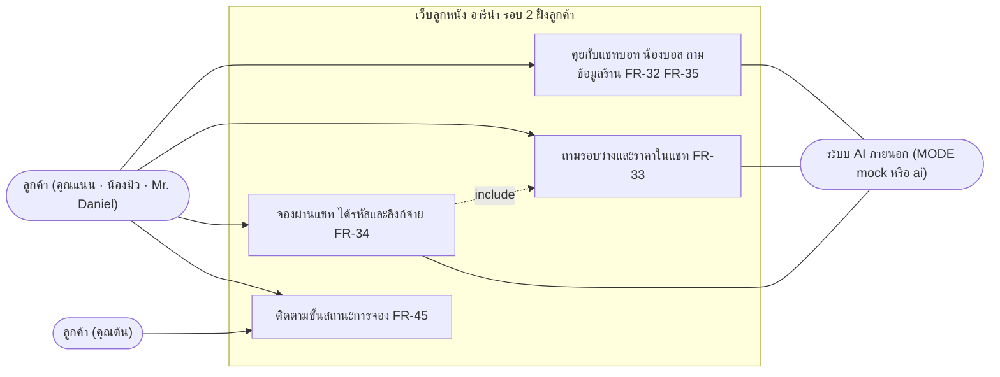

**ฝั่งร้าน**

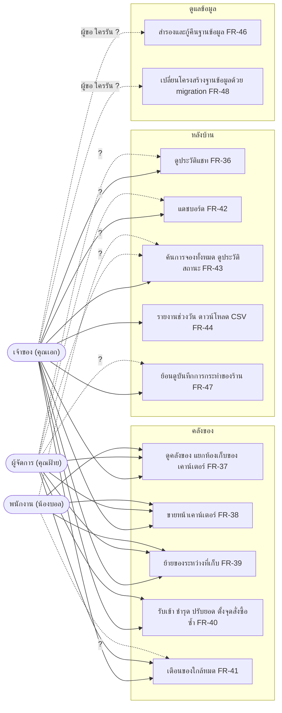

| Use case | FR | BR หลัก | ผู้ใช้ที่ requirement บอกชัด |
|---|---|---|---|
| แชทบอทตอบข้อมูลร้าน | FR-32, FR-35 | BR-29, BR-32 | ลูกค้าทุกคน |
| ถามรอบว่างและราคาในแชท | FR-33 | BR-30 | ลูกค้าทุกคน |
| จองผ่านแชท | FR-34 | BR-31, BR-10 | ลูกค้าทุกคน รวมขาจร (A-31) |
| ติดตามขั้นสถานะการจอง | FR-45 | BR-42 | ลูกค้า (คุณต้น) |
| ดูประวัติแชท | FR-36 | BR-42 | "หลังบ้าน" — ไม่ระบุบทบาท |
| คลังของ ขาย ย้าย | FR-37–FR-39 | BR-33, BR-34, BR-36, BR-37 | พนักงาน ผู้จัดการ เจ้าของ (BR-36) |
| รับเข้า ชำรุด ปรับยอด จุดสั่งซื้อซ้ำ | FR-40 | BR-36, BR-38 | ผู้จัดการ เจ้าของ (BR-36) |
| เตือนของใกล้หมด | FR-41 | BR-35 | "หลังบ้าน" — ไม่ระบุบทบาท |
| แดชบอร์ด · ค้นการจองทั้งหมด | FR-42, FR-43 | BR-40, BR-41, BR-42 | เจ้าของเป็นผู้ขอ — บทบาทอื่นไม่ระบุ |
| รายงาน CSV | FR-44 | BR-39, BR-40 | เจ้าของเท่านั้น (BR-39) |
| สำรอง/กู้คืน · migration | FR-46, FR-48 | BR-43 | ทำด้วยสคริปต์ — ไม่ระบุผู้รัน |
| บันทึกการกระทำของร้าน | FR-47 | BR-42 | บันทึกอัตโนมัติ — ไม่ระบุว่าใครเปิดดู |

## 2. ERD

```mermaid
erDiagram
  Customer ||--o{ Booking : "เป็นเจ้าของ"
  Field ||--o{ Booking : "ถูกจอง"
  Booking ||--o{ Payment : "มี"
  Challenge |o--o| Payment : "เงินที่ทีมรับโอน challengeId CR-06"
  Field ||--o{ FieldRate : "ราคาตามวันมีผล CR-05"
  Customer ||--o{ CreditEntry : "มี"
  Booking |o--o{ CreditEntry : "ที่มา"
  Booking ||--o{ BookingRental : "เช่า"
  RentalItem ||--o{ BookingRental : "ถูกเช่า"
  RecurringSeries |o--o{ Booking : "รวม"
  Customer ||--o{ RecurringSeries : "จอง"
  Booking ||--o{ SplitShare : "หาร"
  Booking ||--o| Challenge : "ประกาศ"
  Customer |o--o{ Challenge : "รับคำท้า"
  Field ||--o{ FieldClosure : "ถูกปิด"
  StaffUser ||--o{ FieldClosure : "สร้าง"
  StockItem ||--o| RentalItem : "id เดียวกัน BIB BALL"
  StockItem ||--o{ StockLevel : "มีจำนวนใน"
  StockLocation ||--o{ StockLevel : "เก็บ"
  StockItem ||--o{ StockMovement : "เข้า-ออก"
  StockLocation |o--o{ StockMovement : "ต้นทาง fromLocationId"
  StockLocation |o--o{ StockMovement : "ปลายทาง toLocationId"
  StaffUser ||--o{ StockMovement : "บันทึก"
  CounterSale |o--o{ StockMovement : "ตัดของจากการขาย"
  StaffUser ||--o{ CounterSale : "ขาย"
  CounterSale ||--|{ CounterSaleItem : "มีรายการ"
  StockItem ||--o{ CounterSaleItem : "ถูกขาย"
  Customer |o--o{ ChatSession : "คุย"
  ChatSession ||--o{ ChatMessage : "มีข้อความ"
  Booking |o--o{ ChatMessage : "สร้างจากแชท ผ่าน bookingCode"
  Booking ||--o{ BookingStatusHistory : "เปลี่ยนสถานะ"
  StaffUser ||--o{ AuditLog : "ทำ"

  Field {
    string id PK
    string name
    int size
    boolean covered
    int dayRate "INTEGER บาท"
    int eveningRate "INTEGER บาท"
    string photo
  }
  Customer {
    int id PK
    string name
    string phone UK
    string passwordHash
    int creditBalance "INTEGER บาท"
    int paidHours
    int freeHoursUsed
    datetime bannedUntil
  }
  Booking {
    int id PK
    string code UK
    int customerId FK
    string customerName
    string fieldId FK
    date date
    int startHour
    int hours
    string status
    string paymentPlan
    int fieldPrice "INTEGER บาท"
    int discount "INTEGER บาท"
    int rentalPrice "INTEGER บาท"
    int creditUsed "INTEGER บาท"
    boolean freeHourUsed
    int totalPrice "INTEGER บาท"
    int payNow "INTEGER บาท"
    int amountPaid "INTEGER บาท"
    int dueAtField "INTEGER บาท"
    datetime payDeadline
    datetime consentAt
    int rescheduleCount
    int seriesId FK
  }
  Payment {
    int id PK
    int bookingId FK
    int amount "INTEGER บาท"
    string method
    datetime paidAt
    int challengeId FK "ว่างได้ มีค่า = เงินที่ทีมรับคำท้าโอน CR-06"
  }
  FieldRate {
    string fieldId PK, FK
    date effectiveFrom PK "วันเตะที่ราคานี้เริ่มมีผล CR-05"
    int dayRate "INTEGER บาท"
    int eveningRate "INTEGER บาท"
    datetime createdAt
  }
  RevokedSession {
    string tokenHash PK "SHA-256 ของ cookie ไม่เก็บ cookie ดิบ CR-01"
    string kind "CUSTOMER STAFF"
    datetime expiresAt
    datetime revokedAt
  }
  CreditEntry {
    int id PK
    int customerId FK
    int amount "INTEGER บาท บวกหรือลบ"
    string reason
    int bookingId FK
    datetime createdAt
  }
  Holiday {
    date date PK
    string name
  }
  FieldClosure {
    int id PK
    string fieldId FK
    date date
    int fromHour
    int toHour
    int createdBy FK
    datetime createdAt
  }
  RentalItem {
    string id PK "เท่ากับ StockItem id"
    string name
    int price "INTEGER บาท"
    int stock "INTEGER ชิ้น"
  }
  BookingRental {
    int bookingId FK
    string itemId FK
    int qty "INTEGER ชิ้น"
    int returnedQty "INTEGER ชิ้น"
  }
  RecurringSeries {
    int id PK
    int customerId FK
    string fieldId FK
    int weekday
    int startHour
    int hours
    int weeksRequested
    int weeksBooked
    int discountPercent
  }
  SplitShare {
    int id PK
    int bookingId FK
    string memberName
    int amount "INTEGER บาท"
    datetime paidAt
  }
  Challenge {
    int id PK
    int bookingId FK
    string teamName
    string level
    string status
    int acceptCustomerId FK
    int amount "INTEGER บาท"
    datetime payDeadline
  }
  StaffUser {
    int id PK
    string name
    string username UK
    string passwordHash
    string role
  }
  StockItem {
    string id PK "BIB BALL WATER ORS TOWEL CONE NET LAMP"
    string name
    string category "RENTAL SALE EQUIPMENT"
    int unitPrice "INTEGER บาท ว่างได้"
    int reorderPoint "INTEGER ชิ้น ว่างได้"
  }
  StockLocation {
    string id PK "STORE COUNTER"
    string name
  }
  StockLevel {
    string itemId PK, FK
    string locationId PK, FK
    int qty "INTEGER ชิ้น CHECK ห้ามติดลบ"
  }
  StockMovement {
    int id PK
    string itemId FK
    string type "RECEIVE SALE TRANSFER DAMAGE ADJUST"
    int qty "INTEGER ชิ้น"
    string fromLocationId FK "ว่างได้"
    string toLocationId FK "ว่างได้"
    string reason
    int staffUserId FK
    int counterSaleId FK "ว่างได้"
    datetime createdAt
  }
  CounterSale {
    int id PK
    int totalAmount "INTEGER บาท"
    string method "CASH PROMPTPAY"
    int staffUserId FK
    datetime createdAt
  }
  CounterSaleItem {
    int saleId FK
    string itemId FK
    int qty "INTEGER ชิ้น"
    int unitPrice "INTEGER บาท ราคาตอนขาย"
  }
  ChatSession {
    string id PK "ชนิดรอถามทีม"
    string lang "th en"
    int customerId FK "ว่างได้"
    datetime createdAt
    datetime lastMessageAt
  }
  ChatMessage {
    int id PK
    string sessionId FK
    string role "USER BOT"
    string text
    string bookingCode "ว่างได้ อ้าง Booking code"
    datetime createdAt
  }
  BookingStatusHistory {
    int id PK
    int bookingId FK
    string fromStatus
    string toStatus
    string actor "CUSTOMER BOT SYSTEM หรือชื่อผู้ใช้ร้าน"
    datetime createdAt
  }
  AuditLog {
    int id PK
    int staffUserId FK
    string action
    string target
    string detail
    datetime createdAt
  }
```

`Holiday` ไม่มีเส้นเชื่อม เพราะใช้เทียบด้วยวันที่ตอนคิดราคา (BR-08)

**ส่วนที่เพิ่มรอบ 2 (10 entity ตาม contract 1.1 ตั้งแต่ `StockItem`):**

- เงินและจำนวนทุกคอลัมน์เป็น `INTEGER` (NFR-19) · Mermaid ERD ให้ชนิดได้คำเดียวจึงเขียน `int` แล้วระบุ "INTEGER บาท" หรือ "INTEGER ชิ้น" ในคำอธิบาย · `StockLevel.qty` ห้ามติดลบด้วย `CHECK` (BR-33, NFR-19)
- `RentalItem.id` = `StockItem.id` (BIB, BALL) ตาม contract 1.4 · จำนวนให้เช่าทั้งหมด = ผลรวม `StockLevel.qty` ของชิ้นนั้นทุกที่เก็บ (BR-38) จึงวาดเป็นเส้น 1 ต่อ 0..1
- `StockMovement` ชี้ `StockLocation` 2 เส้น (`fromLocationId`, `toLocationId`) · ขายมีแค่ต้นทาง COUNTER · `counterSaleId` มีค่าเฉพาะ type SALE
- `ChatMessage.bookingCode` อ้าง `Booking.code` (ไม่ใช่ `Booking.id`) ตาม contract จึงวาดเป็นเส้น 0..1 ต่อหลายข้อความ
- `BookingStatusHistory.actor` เป็นข้อความ (CUSTOMER / BOT / SYSTEM / ชื่อผู้ใช้ร้าน) ไม่ใช่ FK ไป `StaffUser` ตาม contract จึงไม่มีเส้นเชื่อม `StaffUser`
- `BookingStatusHistory` และ `AuditLog` ไม่มีเส้นทางแก้หรือลบ (BR-42)
- ชนิดของ `ChatSession.id` และคีย์หลักของ `CounterSaleItem` contract ไม่ได้ระบุ — ดูหัวข้อ 14

**ส่วนที่เพิ่มตาม Change Request (CR-01…06 · 2026-10-21 · เขียนทีหลัง v2-handover · ค่าอ้าง `04-REQUIREMENTS.md` v3 และ `db/migrations/007–009`):**

- `FieldRate` (ตาราง `field_rates` · migration 008 · **CR-05 · BR-49**) — จุดเปลี่ยนราคาของสนามตามวันเตะ: คีย์คู่ (`fieldId`, `effectiveFrom`) · `Field.dayRate`/`eveningRate` เหลือบทบาท "ราคาฐาน" ใช้ก่อนจุดเปลี่ยนแรก · แถวแรก = สนาม A, B เย็น ฿1,300 ตั้งแต่ 2026-11-01 · การจองที่สร้างแล้วเก็บ `fieldPrice`/`totalPrice` ไว้ในแถว `Booking` จึงไม่ถูกคิดใหม่
- `RevokedSession` (ตาราง `revoked_sessions` · migration 007 · **CR-01 · BR-46**) — cookie เข้าสู่ระบบที่ออกจากระบบแล้ว: เก็บ SHA-256 ของ cookie (`tokenHash`) ไม่เก็บ cookie ดิบ · `kind` CUSTOMER หรือ STAFF · แถวลบได้เมื่อเลย `expiresAt` · ไม่มี FK จึงไม่มีเส้นเชื่อม (cookie ไม่ผูกแถวลูกค้า/พนักงาน)
- `Payment.challengeId` (คอลัมน์ `payments.challenge_id` · migration 009 · **CR-06 · BR-50**) — ว่างได้ · มีค่า = แถวเงินที่ทีมรับคำท้าโอนเข้าบัญชีร้าน (วิธี PROMPTPAY ผูกการจองของเจ้าของคำท้า `paidAt` = ตอนทีมรับจ่าย) · unique index ทำให้ 1 คำท้า = 1 แถวเงิน (วาดเป็นเส้น 0..1 ต่อ 0..1) · เครดิตของเจ้าของคำท้า (`CreditEntry`) ไม่เปลี่ยน
- `Booking` ไม่มีคอลัมน์ใหม่จาก CR-02 · ขั้น "จบ" คำนวณตอนแสดง (BR-48) ไม่ใช่สถานะใหม่ จึงไม่แก้ state diagram หัวข้อ 5

## 3. Sequence — จองครั้งเดียว: เลือกช่วง → จ่าย → เช็กอิน

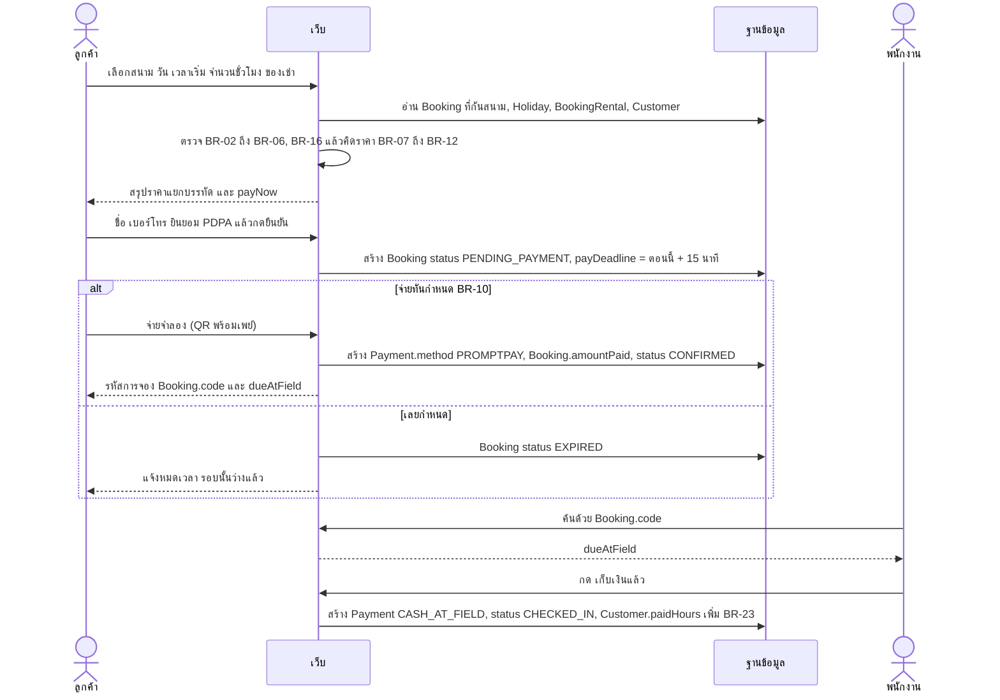

## 4. Sequence — ยกเลิก และปิดเพราะฝน (คืนเครดิต)

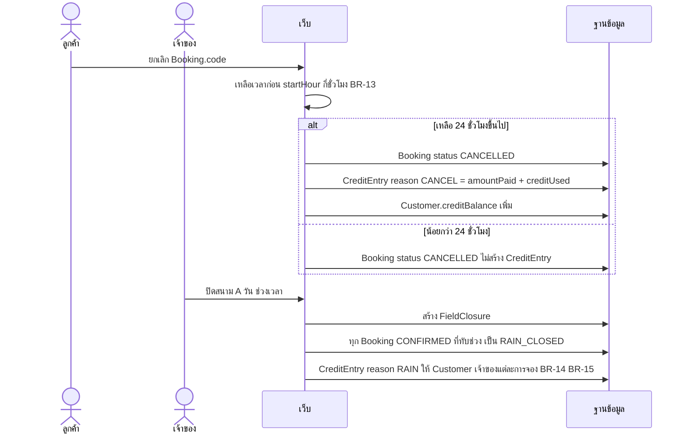

## 5. State — `Booking`

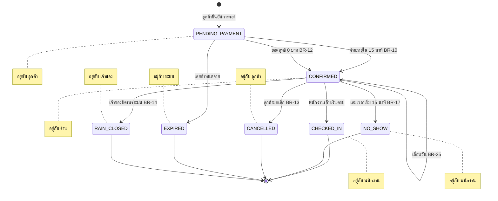

## 6. State — `Challenge`

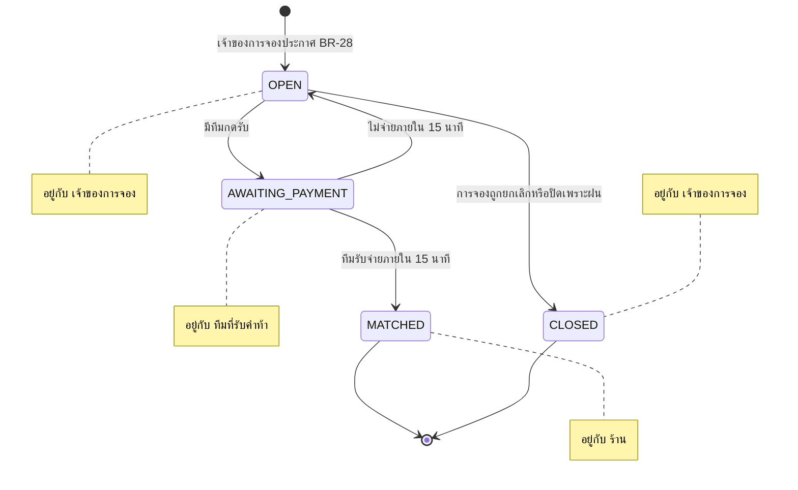

## 7. Activity — คิดราคาและยอดจ่าย (BR-07 ถึง BR-12, BR-19, BR-22, BR-24)

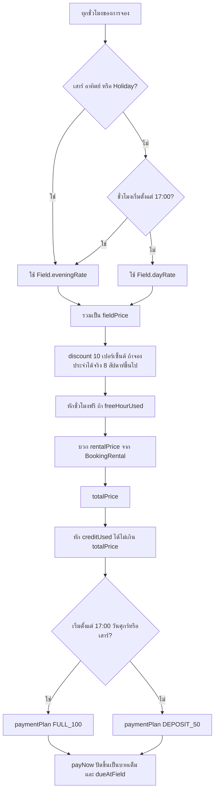

## 8. Flowchart — จองผ่านเว็บหรือแชทบอท (ใช้ฟังก์ชันจองตัวเดียวกัน)

ทั้ง 2 ช่องทางเข้าฟังก์ชันตรวจกฎและคิดราคาตัวเดียวกัน (BR-30, BR-31) · ทุกจุดตัดสินใจระบุรหัส BR

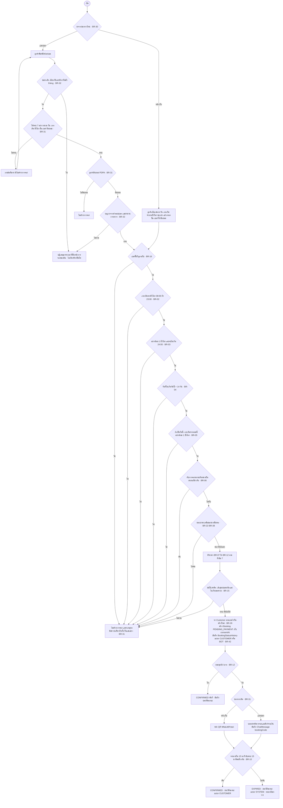

## 9. Flowchart — ลูกค้ายกเลิกการจอง

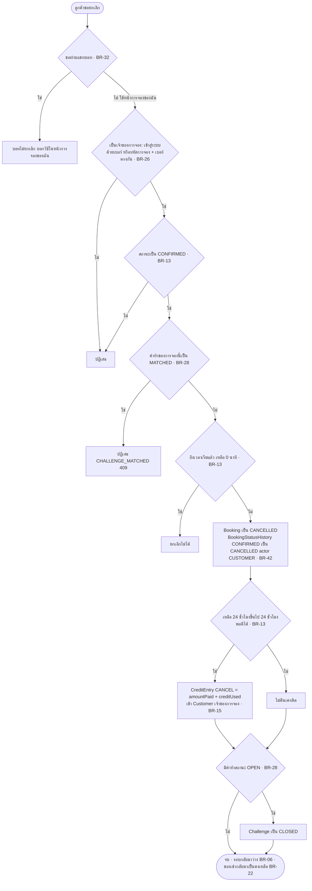

## 10. Sequence — ลูกค้าจองผ่านแชทบอท น้องบอล

`MODE=mock` ตอบตามกฎตายตัว · `MODE=ai` เรียก endpoint แบบ OpenAI ผ่าน gateway (NFR-15) · ทั้ง 2 โหมดคืน tag แบบเดียวกัน แล้ว backend เป็นผู้ตรวจและเรียกฟังก์ชันจริง (NFR-17)

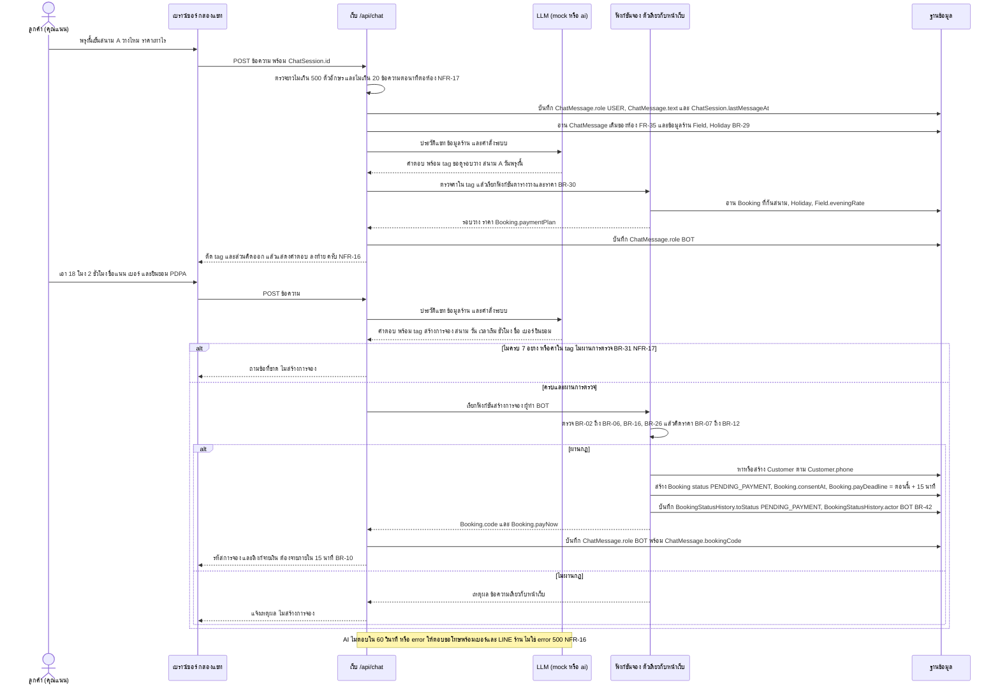

## 11. Sequence — พนักงานขายหน้าเคาน์เตอร์

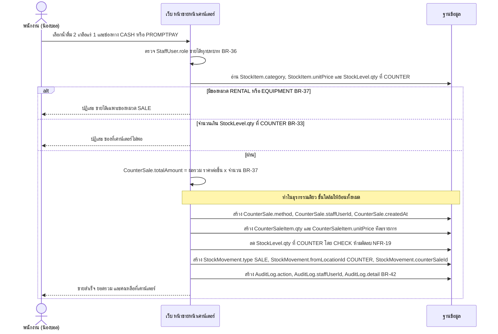

## 12. Sequence — ย้ายของระหว่างที่เก็บ และปรับยอดหลังนับจริง

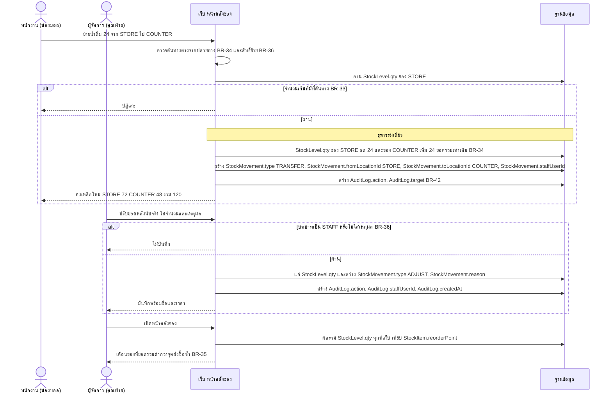

## 13. Sequence — แดชบอร์ด และรายงาน CSV ของเจ้าของ

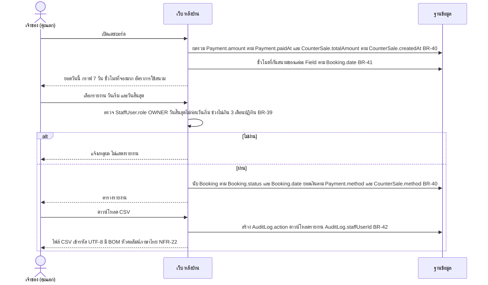

## 14. คำถามที่ได้จากการออกแบบ

เรื่องที่ requirement (`04-REQUIREMENTS.md`) ไม่ได้บอก พบระหว่างวาดแผนภาพ · **ยังไม่ตัดสินใจ** ส่งให้ร้านหรือทีมตอบ

| รหัส | พบที่ | คำถาม | กระทบ |
|---|---|---|---|
| Q-SA-01 | ERD | `ChatSession.id` เป็นเลขรันหรือข้อความสุ่ม · ลูกค้าขาจรใช้ห้องโดยไม่เข้าสู่ระบบ ถ้าเป็นเลขรันคนอื่นเดาเลขห้องแล้วอ่านแชทที่มีชื่อและเบอร์ได้หรือไม่ | ERD, NFR-05 |
| Q-SA-02 | ERD | `CounterSaleItem` และ `BookingRental` ใช้อะไรเป็นคีย์หลัก · ขายของชิ้นเดียวกัน 2 บรรทัดในการขายเดียวได้ไหม | ERD |
| Q-SA-03 | Use case | ดูประวัติแชท (FR-36) แดชบอร์ด (FR-42) ค้นการจองทั้งหมด (FR-43) เปิดได้บทบาทไหนบ้าง · requirement บอกแค่ "หลังบ้าน" และเจ้าของเป็นผู้ขอ | FR-31, NFR-05 |
| Q-SA-04 | Use case | ใครเปิดดู `AuditLog` ในเว็บได้ · FR-47 บอกแค่ให้บันทึกและห้ามแก้ลบ | FR-47 |
| Q-SA-05 | Use case | เตือนของใกล้หมด (FR-41) แสดงให้พนักงานด้วยหรือเฉพาะผู้จัดการและเจ้าของ | BR-35, BR-36 |
| Q-SA-06 | Use case | สำรอง กู้คืน และ migration ใครเป็นผู้รัน (เจ้าของ หรือผู้ดูแลระบบ) · มีปุ่มในเว็บหรือใช้สคริปต์อย่างเดียว · ต้องบันทึกใน `AuditLog` ไหม ถ้าบันทึก `staffUserId` เป็นใคร | FR-46, FR-48, BR-42 |
| Q-SA-07 | Use case | แชทบอทกับพนักงานชื่อ "น้องบอล" เหมือนกัน · หน้าประวัติสถานะจะแยก actor BOT กับพนักงานน้องบอลให้คนอ่านเข้าใจอย่างไร | BR-42, FR-45 |
| Q-SA-08 | Flowchart 8 | จองผ่านแชท BR-31 ระบุ 7 อย่าง ไม่มีของเช่า เครดิต ชั่วโมงฟรี จองประจำ · บอทรับของเหล่านี้ได้ไหม ถ้าสมาชิกเข้าสู่ระบบแล้วแชท ใช้เครดิตผ่านบอทได้ไหม (BR-15) | BR-15, BR-24, BR-31 |
| Q-SA-09 | Flowchart 8 | ก่อนบอทสร้างการจอง ต้องให้ลูกค้าพิมพ์ "ยืนยัน" อีกครั้งหลังเห็นราคาเหมือนปุ่มยืนยันหน้าเว็บไหม หรือครบ 7 อย่างแล้วสร้างทันที | BR-31, FR-05 |
| Q-SA-10 | Sequence 10 | ลิงก์จ่ายเงินที่บอทส่งเปิดได้ด้วยรหัสการจองอย่างเดียว หรือต้องใส่เบอร์ด้วยเหมือน FR-09 · ใครได้ลิงก์ไปจะเห็นชื่อและยอดเงินหรือไม่ | FR-09, NFR-05 |
| Q-SA-11 | Sequence 10 | `ChatSession.customerId` ใส่ค่าเมื่อไร · ตอนบอทสร้างการจองให้ขาจรแล้วผูกห้องกับ `Customer` ตามเบอร์ไหม · `ChatSession.lang` ตั้งครั้งเดียวหรือเปลี่ยนตามข้อความล่าสุด | FR-35, FR-36 |
| Q-SA-12 | Sequence 10 | ข้อความที่ถูกปฏิเสธเพราะยาวเกิน 500 ตัวอักษรหรือเกิน 20 ข้อความต่อนาที เก็บใน `ChatMessage` ไหม · ประวัติแชทมีชื่อและเบอร์ เก็บนานเท่าไรตาม PDPA | NFR-04, NFR-17 |
| Q-SA-13 | Flowchart 9 | ยกเลิกการจองที่ยัง `PENDING_PAYMENT` ได้ไหม · state diagram มีแค่ `CONFIRMED` ไป `CANCELLED` · ถ้าไม่ได้ ลูกค้าต้องรอ 15 นาทีให้หมดอายุเอง | BR-13, FR-10 |
| Q-SA-14 | Flowchart 9 | ยกเลิกการจองที่คำท้าเป็น `AWAITING_PAYMENT` (ทีมรับกำลังจ่าย) ได้ไหม · BR-25 ห้ามเลื่อนในสถานะนี้ แต่ไม่ได้พูดเรื่องยกเลิก · state diagram ไม่มี `AWAITING_PAYMENT` ไป `CLOSED` | BR-13, BR-28 |
| Q-SA-15 | Flowchart 9 | ยกเลิกเหลือ 24 ชั่วโมงขึ้นไป คืนสิทธิ์ชั่วโมงฟรีที่ใช้ไปไหม · BR-13 พูดแค่เงินที่จ่ายกับเครดิต | BR-13, BR-24 |
| Q-SA-16 | ERD | `BookingStatusHistory` ตอนสร้างการจอง `fromStatus` เป็นค่าว่างไหม · เลื่อนวัน (`CONFIRMED` ไป `CONFIRMED`) ถือเป็นการเปลี่ยนสถานะที่ต้องบันทึกไหม · การจองเก่าก่อนรอบ 2 ไม่มีประวัติ ต้องเติมตอน migration ไหม | BR-42, BR-43, FR-45 |
| Q-SA-17 | ERD | `BookingStatusHistory.actor` เก็บ `StaffUser.name` หรือ `StaffUser.username` · ถ้าเปลี่ยนชื่อผู้ใช้ร้านภายหลัง ประวัติเดิมยังชี้คนเดิมได้อย่างไร | BR-42 |
| Q-SA-18 | ERD | `RentalItem.stock` และ `RentalItem.price` ซ้ำกับผลรวม `StockLevel.qty` และ `StockItem.unitPrice` ของ BIB BALL · ค่าไหนเป็นตัวจริง ถ้าไม่ตรงกันใช้ค่าไหน | BR-22, BR-38 |
| Q-SA-19 | Sequence 12 | `StockMovement.qty` เก็บเป็นบวกเสมอแล้วดูทิศจาก type หรือเก็บบวกลบ · ADJUST และ DAMAGE ใส่ที่เก็บใน `fromLocationId` หรือ `toLocationId` · RECEIVE รับเข้าที่ไหน เลือกได้หรือเข้าห้องเก็บของเสมอ | BR-33, BR-36 |
| Q-SA-20 | Sequence 12 | เอี๊ยมหรือบอลที่ถูกเช่าอยู่แล้วบันทึกชำรุด จนยอดในคลังน้อยกว่าที่ถูกเช่าในช่วงนั้น · การจองที่เช่าไว้แล้วเป็นอย่างไร (BR-38 ลดจำนวนให้เช่าทันที) | BR-22, BR-38 |
| Q-SA-21 | Sequence 11 | การขายหน้าเคาน์เตอร์ต้องเขียนทั้ง `StockMovement` และ `AuditLog` ซึ่งข้อมูลซ้ำกัน · ต้องการทั้งคู่ไหม · ขายผิดแล้วยกเลิกหรือคืนของได้ไหม (ไม่มี type คืน และห้ามลบบันทึก) | BR-37, BR-42 |
| Q-SA-22 | Sequence 11 | ขายแบบ PROMPTPAY ต้องมีขั้นยืนยันการจ่ายจำลองและกำหนดเวลาเหมือนจองไหม หรือบันทึกทันที | A-30, FR-38 |
| Q-SA-23 | Sequence 13 | ยอดเงินวันนี้ในแดชบอร์ดและรายงานรวม `Payment.method` CREDIT ด้วยไหม · เครดิตไม่ใช่เงินเข้าจริง แต่รายงานขอ "หักเครดิต" แยกช่อง | BR-40, FR-42, FR-44 |
| Q-SA-24 | Sequence 13 | ในรายงาน ส่วนลดจองประจำ ชั่วโมงฟรี ค่าของเช่า จำนวนไม่มา นับตามวันเตะหรือวันรับเงิน · BR-40 ระบุแค่ยอดเงินกับจำนวนการจอง | BR-40, FR-44 |
| Q-SA-25 | Sequence 13 | "ชั่วโมงที่จองมาก" ในแดชบอร์ดนับช่วงกี่วัน และนับสถานะไหนบ้าง | FR-42, BR-41 |
| Q-SA-26 | ERD | `AuditLog.action`, `AuditLog.target`, `AuditLog.detail` ใช้รูปแบบอะไร (รายการคำคงที่ หรือข้อความอิสระ) · รายงานและหน้าค้นต้องกรองตาม action ได้ไหม | BR-42, FR-47 |

> **ตอบแล้ว 2026-10-18:** คำถามธุรกิจ → คำตอบร้าน A-33–A-40 ใน `01-INTERVIEW.md` · คำถามเทคนิค → การตัดสินของทีม T-13–T-24 ใน `04-REQUIREMENTS.md` ส่วนที่ 7.1 · ข้อที่ไม่ได้อยู่ในสองที่นี้ ให้ผู้สร้างเลือกค่าชั่วคราวที่เขียนไว้ในคำถามและจดใน `web/SPEC.md` หัวข้อ "สมมติฐานของผู้สร้าง"
