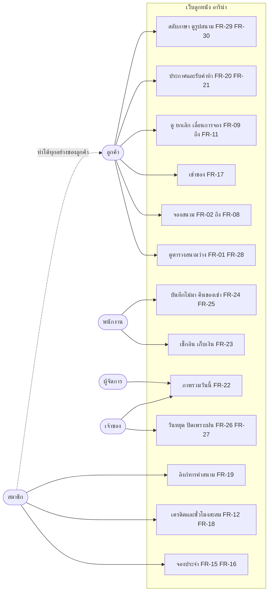
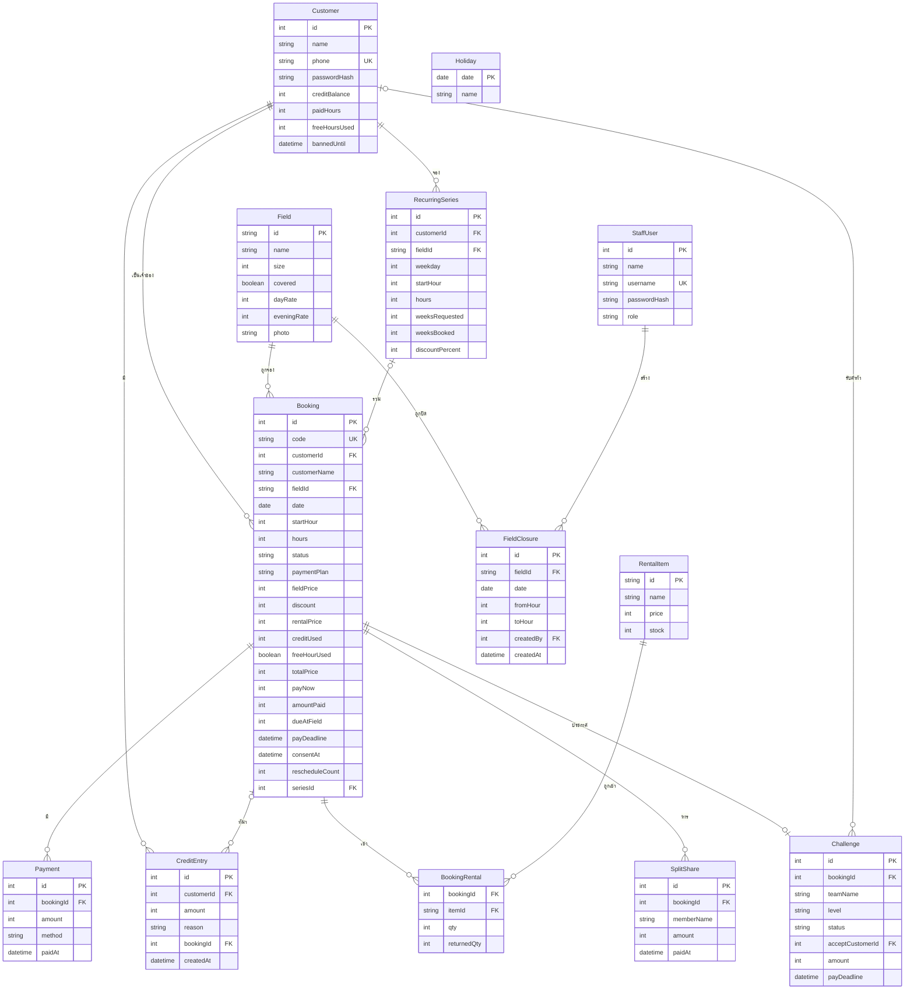
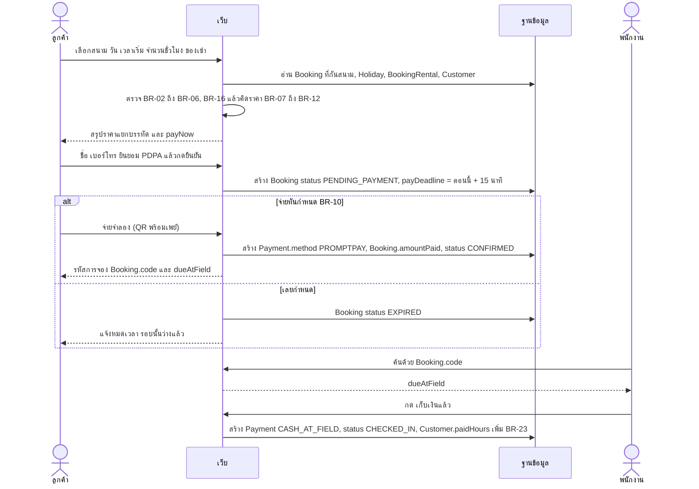
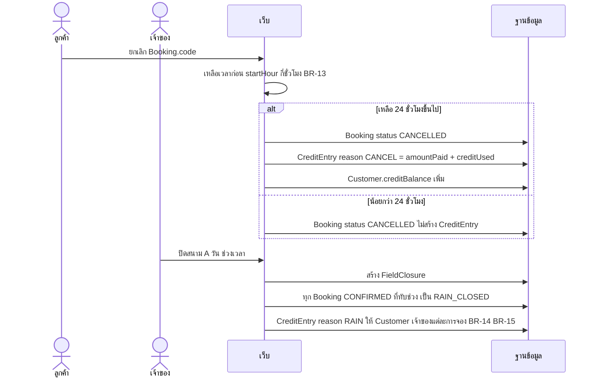
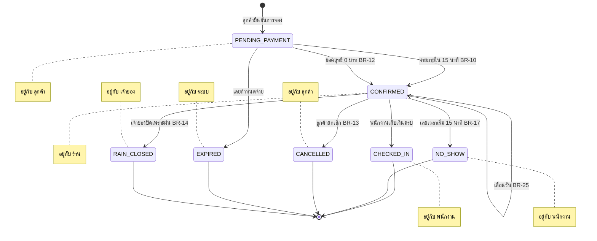
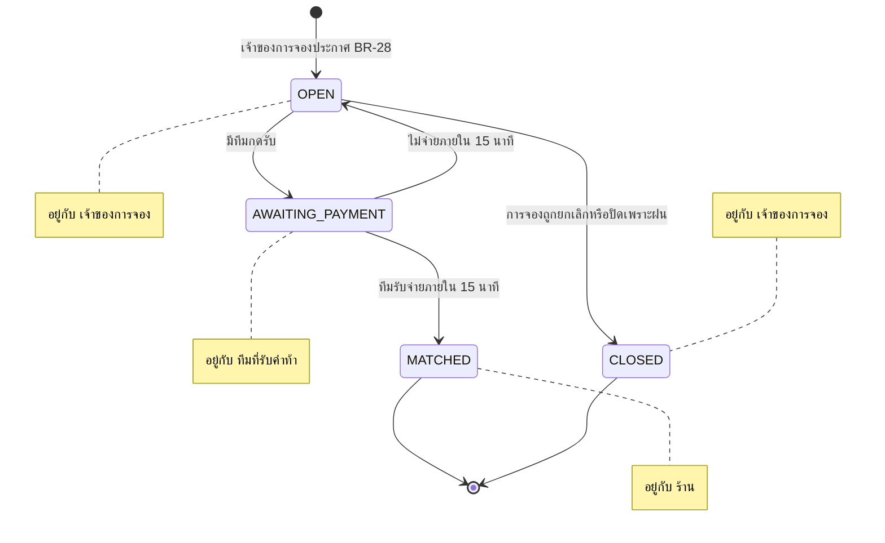
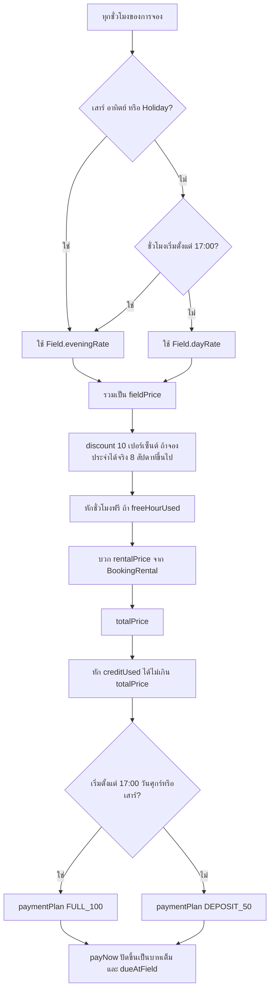

# 06 · System Analysis — ลูกหนัง อารีน่า

ใช้ชื่อ entity / attribute / สถานะตาม contract ใน [`04-REQUIREMENTS.md`](04-REQUIREMENTS.md) ส่วนที่ 1 เท่านั้น
แผนภาพทุกภาพเป็น Mermaid และตรวจ render ด้วย `tools/render-mermaid.mjs`

## 1. Use Case

ผู้ใช้ 5 กลุ่ม: ลูกค้า (ยังไม่สมัคร), สมาชิก, พนักงาน (STAFF), ผู้จัดการ (MANAGER), เจ้าของ (OWNER)

## 2. ERD

`Holiday` ไม่มีเส้นเชื่อม เพราะใช้เทียบด้วยวันที่ตอนคิดราคา (BR-08)

## 3. Sequence — จองครั้งเดียว: เลือกช่วง → จ่าย → เช็กอิน

## 4. Sequence — ยกเลิก และปิดเพราะฝน (คืนเครดิต)

## 5. State — `Booking`

## 6. State — `Challenge`

## 7. Activity — คิดราคาและยอดจ่าย (BR-07 ถึง BR-12, BR-19, BR-22, BR-24)

