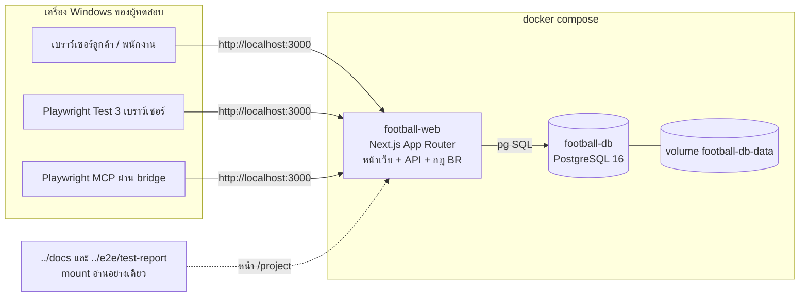

# 07 · Software Architecture Document — ลูกหนัง อารีน่า

อ้างอิงชื่อกลางจาก [`04-REQUIREMENTS.md`](04-REQUIREMENTS.md) ส่วนที่ 1 · รูปแบบตามบทเรียน 00_tester/03 (`spa/SPEC.md`) + ADR

## 1. ภาพรวมสถาปัตยกรรม

| ชั้น | อยู่ที่ | ทำอะไร |
|---|---|---|
| หน้าเว็บ (React Server/Client Components) | `football-web` | หน้าลูกค้า หน้าร้าน หน้า /project |
| API (Route Handlers `/api/*`) | `football-web` | รับคำขอ ตรวจสิทธิ์ เรียกกฎ |
| กฎธุรกิจ (`lib/rules/*` ฟังก์ชันบริสุทธิ์) | `football-web` | BR-02–BR-28 ใช้ร่วมกันทั้งหน้าเว็บ (แสดงราคา) และ API (ตรวจซ้ำฝั่ง server) |
| ข้อมูล | `football-db` | ตาราง 13 ตารางตาม contract |

## 2. Deployment (docker compose)

| service | container | image / build | พอร์ต | สำคัญ |
|---|---|---|---|---|
| `db` | `football-db` | `postgres:16-alpine` | ไม่เปิดออกเครื่อง | healthcheck `pg_isready` · volume `football-db-data` (NFR-06) · `TZ=Asia/Bangkok` |
| `web` | `football-web` | build `web/Dockerfile` (multi-stage, `output: "standalone"`, node 24, non-root) | `3000:3000` | `depends_on: db: service_healthy` · healthcheck ด้วย node เรียก `/api/health` · `ALLOW_TEST_RESET=1` · `BUG_MODE=${BUG_MODE:-0}` · `TZ=Asia/Bangkok` · mount `../docs:/app/project/docs:ro` และ `../e2e/test-report:/app/project/test-report:ro` |

ข้อกำหนดที่ได้จากบทเรียนและเฟส 0:
- ห้ามต่อฐานข้อมูลตอน `next build` (หน้าใช้ข้อมูลเป็น dynamic) — 00_tester/03
- web สร้างตารางและ seed เองตอนเริ่มถ้ายังไม่มี (idempotent)
- ไฟล์ทั้งหมด LF (`.gitattributes`) · ไม่มี .sh ที่ผู้ใช้ต้องรัน · ใช้ได้ใน PowerShell (NFR-14)
- path โปรเจกต์มีช่องว่าง: ทดสอบแล้วว่า compose build และ mount ทำงาน (ดู `00-ENVIRONMENT.md`)

## 3. หน้าเว็บ

| path | ผู้ใช้ | ทำอะไร | FR |
|---|---|---|---|
| `/` | ทุกคน | แนะนำร้าน รูป 3 สนาม ปุ่ม "ดูสนามว่างวันนี้" | FR-01, FR-30 |
| `/book` | ลูกค้า | ตารางว่างตามวัน (เลือกวัน) ตัวกรองก่อน 17:00 · เรียงตามราคา | FR-01, FR-28 |
| `/book/new` | ลูกค้า | เลือกชั่วโมง ของเช่า เครดิต ชั่วโมงฟรี ฟอร์มลูกค้า + PDPA สรุปราคาแยกบรรทัด | FR-02–FR-05, FR-12, FR-17, FR-18 |
| `/pay/[code]` | ลูกค้า | QR PromptPay จำลอง นับถอยหลัง ปุ่มยืนยันการจ่าย | FR-06, FR-07 |
| `/booking/[code]` | ลูกค้า | รายละเอียด รหัส ยอดเก็บหน้าสนาม ปุ่มยกเลิก/เลื่อน/ลิงก์หาร/ประกาศหาคู่ | FR-08–FR-11, FR-19, FR-20 |
| `/my` | ลูกค้า/สมาชิก | เข้าสู่ระบบ/สมัคร · การจองของฉัน · เครดิต + ประวัติ · ชั่วโมงสะสม "อีก N ชั่วโมง" · ค้นด้วยรหัส+เบอร์ | FR-09, FR-12, FR-13, FR-14, FR-18 |
| `/series` | สมาชิก | จองประจำ: ตัวอย่างราคา สัปดาห์ที่ชน เลือกจองเฉพาะที่ว่าง | FR-15, FR-16 |
| `/split/[token]` | ลูกทีม | ยอดต่อคน สถานะรายคน | FR-19 |
| `/challenges` | ทุกคน | รายการประกาศ กรองระดับ รับคำท้า จ่ายครึ่ง | FR-20, FR-21 |
| `/fields` | ทุกคน | รูป ขนาด กลางแจ้ง/มีหลังคา | FR-30 |
| `/staff/login` | ร้าน | เข้าสู่ระบบตามบทบาท | FR-31 |
| `/staff` | STAFF | ค้นรหัส เก็บเงิน/เช็กอิน ไม่มา คืนของเช่า | FR-23–FR-25 |
| `/staff/today` | MANAGER, OWNER | ภาพรวมวันนี้ | FR-22 |
| `/owner` | OWNER | วันหยุด ปิดเพราะฝน | FR-26, FR-27 |
| `/project` ⭐ | ทุกคน | เอกสาร + traceability + ผลทดสอบล่าสุด (เฟส 10) | — |

ทุกหน้ามีปุ่มสลับภาษา TH/EN (cookie `lang`) — FR-29, NFR-03

## 4. API

| method | path | ทำอะไร | สิทธิ์ | FR |
|---|---|---|---|---|
| GET | `/api/health` | `{ ok, db }` | – | NFR-12 |
| GET | `/api/fields` | ข้อมูล 3 สนาม | – | FR-30 |
| GET | `/api/availability?date=` | ทุกรอบของ 3 สนาม: ว่าง/ไม่ว่าง ราคา | – | FR-01, FR-28 |
| POST | `/api/quote` | คิดราคาแยกบรรทัด + payNow โดยไม่สร้างการจอง | – | FR-05 |
| POST | `/api/bookings` | สร้างการจอง `PENDING_PAYMENT` (ตรวจ BR ทั้งหมดฝั่ง server) | – | FR-02–FR-04 |
| POST | `/api/bookings/{code}/pay` | จ่ายจำลอง | เบอร์ตรงกับการจอง | FR-06 |
| GET | `/api/bookings/{code}?phone=` | รายละเอียดการจอง | เบอร์ตรง หรือเจ้าของที่เข้าสู่ระบบ | FR-08, FR-09 |
| POST | `/api/bookings/{code}/cancel` | ยกเลิก + เครดิต | เจ้าของการจอง | FR-10 |
| POST | `/api/bookings/{code}/reschedule` | เลื่อนวัน | เจ้าของการจอง | FR-11 |
| POST | `/api/customers/register` · `/login` · `/logout` | สมาชิก | – | FR-13 |
| GET | `/api/me` | ข้อมูลตัวเอง เครดิต ชั่วโมงสะสม สิทธิ์ฟรี การจอง | ลูกค้าที่เข้าสู่ระบบ | FR-09, FR-12, FR-14, FR-18 |
| POST | `/api/series/preview` · `/api/series` | จองประจำ: ตัวอย่าง+สัปดาห์ชน / สร้าง | สมาชิก | FR-15, FR-16 |
| GET | `/api/rentals/availability?date=&startHour=&hours=` | ของเช่าคงเหลือ | – | FR-17 |
| POST | `/api/bookings/{code}/split` · GET `/api/split/{token}` · POST `/api/split/{token}/{shareId}/paid` | ลิงก์หาร | เจ้าของการจอง / ผู้มีลิงก์ | FR-19 |
| GET | `/api/challenges?level=` · POST `/api/challenges` · POST `/api/challenges/{id}/accept` · POST `/api/challenges/{id}/pay` | หาคู่แข่ง | ประกาศ: เจ้าของการจอง | FR-20, FR-21 |
| POST | `/api/staff/login` · `/logout` | เข้าสู่ระบบร้าน | – | FR-31 |
| GET | `/api/staff/bookings/{code}` · POST `.../checkin` · `.../no-show` · `.../return-rentals` | หน้าสนาม | STAFF ขึ้นไป | FR-23–FR-25 |
| GET | `/api/staff/today?date=` | ภาพรวม | MANAGER, OWNER | FR-22 |
| GET/POST/DELETE | `/api/owner/holidays` | วันหยุด | OWNER | FR-26 |
| POST | `/api/owner/closures` | ปิดเพราะฝน | OWNER | FR-27 |
| POST | `/api/test/reset` | ล้างข้อมูลกลับ seed + ตั้ง `{ now }` | เฉพาะ `ALLOW_TEST_RESET=1` | NFR-10 |
| POST | `/api/test/clock` | ตั้ง "ตอนนี้" ใหม่ `{ now }` | เฉพาะ `ALLOW_TEST_RESET=1` | NFR-10 |

ข้อผิดพลาดตอบรูปแบบเดียว `{ error: { code, message } }` · ข้อความภาษาไทย/อังกฤษตาม `lang` · ข้อความคงที่ทุกตัวอักษรจะกำหนดใน `web/SPEC.md` (เฟส 4)

## 5. ตารางข้อมูล (PostgreSQL)

ตารางตาม entity ใน contract (ชื่อตาราง snake_case พหูพจน์): `fields`, `customers`, `bookings`, `payments`, `credit_entries`, `holidays`, `field_closures`, `rental_items`, `booking_rentals`, `recurring_series`, `split_shares`, `challenges`, `staff_users`

- เงินเก็บเป็นจำนวนเต็มบาท (`integer`) ไม่มีทศนิยม
- `customers.phone` UNIQUE (BR-26) · `bookings.code` UNIQUE
- index `bookings(field_id, date)` สำหรับตรวจทับเวลา

## 6. การตัดสินใจทางเทคนิค (ADR)

| # | เรื่อง | ตัดสินใจ | เหตุผล |
|---|---|---|---|
| ADR-01 | ORM | ใช้ `pg` เขียน SQL ตรง | ตามแบบบทเรียน 00_tester/03 · เห็น SQL ชัดเวลาดีบั๊ก |
| ADR-02 | กันจองซ้อนพร้อมกัน (NFR-07) | ทำในทรานแซกชันเดียว: `pg_advisory_xact_lock(สนาม+วัน)` → ตรวจทับเวลา → insert | ล็อกเฉพาะสนาม+วันนั้น ไม่ล็อกทั้งตาราง |
| ADR-03 | หมดเวลาจ่าย (BR-10, BR-28) | ตรวจแบบ lazy: ก่อนทุกคำขอที่อ่าน/เขียนการจอง เปลี่ยน `PENDING_PAYMENT` / `AWAITING_PAYMENT` ที่เลยกำหนดเป็น `EXPIRED` / `OPEN` | ไม่ต้องมี cron · ทำงานถูกกับเวลาที่ล็อกไว้ |
| ADR-04 | เวลา "ตอนนี้" (NFR-10) | ทุกกฎเรียก `now()` ของแอปเท่านั้น · ปกติเป็นเวลาจริง · ถ้าตั้งด้วย `/api/test/reset` หรือ `/api/test/clock` จะใช้ค่านั้นจนกว่าจะตั้งใหม่ | test กำหนดวันที่ได้แน่นอน ผลเหมือนเดิมทุกวัน (บทเรียน 00_tester/03) |
| ADR-05 | กฎใช้ร่วม client/server | `lib/rules/*` เป็นฟังก์ชันบริสุทธิ์ ไม่แตะฐานข้อมูล | ราคาที่เห็นบนหน้าจอ = ราคาที่ server คิด |
| ADR-06 | ภาษา | dictionary TH/EN ในโค้ด เลือกด้วย cookie `lang` | ไม่ต้องพึ่งบริการแปลภายนอก |
| ADR-07 | การยืนยันตัวตน | ลูกค้า: เบอร์+รหัสผ่าน (สมาชิก) หรือ รหัสการจอง+เบอร์ · ร้าน: username+รหัสผ่าน+บทบาท · session ใน cookie httpOnly · รหัสผ่านเก็บแบบ hash (`scrypt`) | ตาม FR-09, FR-13, FR-31 · ไม่เก็บรหัสผ่านตรง ๆ |
| ADR-08 | การจ่ายเงิน | จำลอง PromptPay: แสดง QR ตัวอย่าง + ปุ่มยืนยัน | ขอบเขตไม่รวมการรับเงินจริง (02-BA) |
| ADR-09 | หน้า /project | อ่าน md และผลทดสอบจาก volume ที่ mount ตอนรัน | ผลทดสอบเกิดหลัง build เสมอ (บทวิเคราะห์แผน v2) |

## 7. การออกแบบให้ทดสอบได้

| สิ่งที่ต้องมี | รายละเอียด | NFR |
|---|---|---|
| `data-testid` | ทุกปุ่ม ช่องกรอก ผลลัพธ์ ข้อความ error · รายชื่อเต็มอยู่ใน `web/SPEC.md` | NFR-09 |
| `<html>` attributes | `data-ready="true"` เมื่อหน้าโหลดข้อมูลเสร็จ · `data-bug-mode="0|1"` | NFR-09, NFR-11 |
| reset + ล็อกเวลา | `POST /api/test/reset { "now": "2026-10-09T10:00:00+07:00" }` คืน seed และตั้งเวลา · `POST /api/test/clock` เลื่อนเวลา | NFR-10 |
| seed ที่แน่นอน | สนาม 3 · ของเช่า 2 · วันหยุด 5 (A-01 ไม่ย้ายข้อมูลเก่า) · ผู้ใช้ร้าน 3 บทบาท · ลูกค้าตัวอย่างที่มีเครดิต / ชั่วโมงสะสม 7 และ 10 / ไม่มา 1 ครั้ง · การจองตัวอย่างที่ทำให้ตารางมีช่องไม่ว่าง | NFR-10 |
| BUG_MODE | อ่าน `process.env.BUG_MODE === "1"` ตอนรัน · บั๊กที่ฝังกำหนดในเฟส 4 และเขียนเฉพาะ `web/BUGS.md` (ผู้เขียน test ห้ามเห็น) | NFR-11 |
| health | `GET /api/health` → `{ ok: true, db: true }` ใช้ใน healthcheck และ global-setup ของ test | NFR-12 |
| accessibility | label ทุกช่อง · ปุ่มจริง · alt ทุกรูป | NFR-13 |

## 8. ความปลอดภัยพื้นฐาน

- `/api/test/*` ตอบ 404 เมื่อไม่ได้ตั้ง `ALLOW_TEST_RESET=1`
- API หน้าร้านตรวจบทบาททุกคำขอ (NFR-05) · ลูกค้าเข้าถึงการจองได้เมื่อเบอร์ตรงหรือเป็นเจ้าของที่เข้าสู่ระบบ
- ไม่แสดงเบอร์โทรเต็มในหน้าประกาศหาคู่แข่ง (NFR-04)
- ราคาและสิทธิ์ทั้งหมดคิดซ้ำที่ server ไม่เชื่อค่าราคาที่ส่งมาจากเบราว์เซอร์
