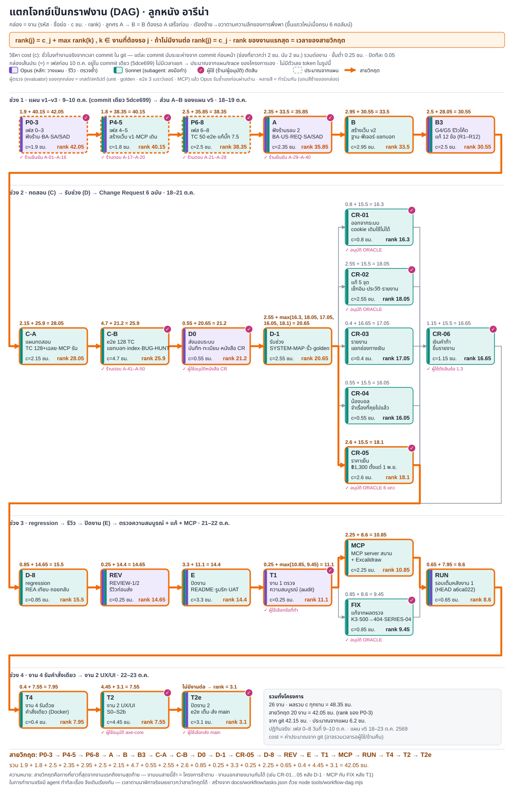

# กราฟงานของโครงการ (DAG) · ลูกหนัง อารีน่า



(ไฟล์ภาพ: [`workflow-dag.svg`](workflow-dag.svg) · [`workflow-dag.png`](workflow-dag.png) · ข้อมูลต้นทาง: [`tasks.json`](tasks.json))

ทำตามบท "แตกโจทย์เป็นกราฟงาน (DAG)" ของอาจารย์: แตกงานทั้งโครงการเป็นกล่อง ลูกศรบอกว่า "ต้องรองานก่อนหน้าเสร็จ" แล้วคำนวณ rank และสายวิกฤต

## วิธีอ่านรูป

- **กล่อง** = 1 งาน: รหัส · ชื่อย่อ · `c` (ชั่วโมงทำงาน) · `rank`
- **ลูกศร A → B** = B ต้องรอ A เสร็จก่อน
- **สูตร** `rank(j) = c_j + max rank(k)` โดย k คืองานที่ต้องรอ j · งานท้ายสุดไม่มีงานต่อ rank = c
- **บรรทัดเหนือกล่อง** แสดงการคำนวณจริง เช่น `0.25 + max(10.85, 9.45) = 11.1`
- **สายวิกฤต** = ทางที่ยาวที่สุดจากงานแรกถึงงานสุดท้าย (ลูกศรส้มหนา + กรอบส้ม) · rank ของงานแรกสุด = เวลารวมของสายนี้ · งานบนสายนี้ช้า โครงการช้าตาม · งานนอกสายขนานกันได้
- **สีกล่อง** = ใครทำ: ม่วง = Opus (session หลัก: วางแผน · รีวิว · ตรวจซ้ำ) · เขียวน้ำทะเล = Sonnet (subagent ลงมือทำ) · แถบสีสองแถบทางซ้าย = ทำร่วมกัน
- **ป้าย ✓ สีชมพู** = จุดที่ผู้ใช้ (ในฐานะร้าน/ผู้อนุมัติ) ต้องตัดสิน เช่น คำตอบร้าน A-xx · อนุมัติแถว ORACLE · อนุมัติหนังสือ CR · เลือกส่ง main
- **กรอบเส้นประ (≈)** = ประมาณจากแผน (ดูหัวข้อถัดไป)
- **ผู้ตรวจ (evaluator)** ของทุกกล่องคือเทสต์/สคริปต์ (unit · golden · e2e 3 เบราว์เซอร์ · MCP) แล้ว Opus รันซ้ำเองก่อนผ่านด่าน (G7) — ไม่ได้วาดเป็นกล่องแยก
- รูปยาว จึงเรียงซ้าย→ขวาตามความลึกของการพึ่งพา แล้วขึ้นแถวใหม่ทุก 6 คอลัมน์ (ลูกศรกลับไปต้นแถวถัดไปคือการต่อแถว)

## วิธีหา cost (`c`) — ชั่วโมงทำงานจาก git

1. เรียง commit ทั้ง repo ตามเวลา (`git log --reverse`, เวลา author)
2. แต่ละ commit นับ **ระยะห่างจาก commit ก่อนหน้าใน repo** · ช่องที่ยาวกว่า **2 ชม. นับเป็น 2 ชม.** (กันข้ามคืน/พัก)
3. `c` ของงาน = ผลรวมของ commit ทั้งหมดของงานนั้น · **ขั้นต่ำ 0.25 ชม.** · ปัดทีละ 0.05
4. งานที่มาจาก git เก็บรายการ commit (`commits`) · ช่วงเวลา (`period`) · ระยะห่างรายช่อง (`gapsHours`) ไว้ใน `tasks.json` ตรวจซ้ำได้

ทำไมนับ "ถึง commit ก่อนหน้า" แทนที่จะนับ (commit สุดท้าย − commit แรก) ของงาน: งานที่มี commit เดียว (เช่น B2 สร้างฟีเจอร์ทั้งก้อน) จะได้ 0.25 ชม. ทั้งที่ทำจริงหลายชั่วโมง วิธีนี้ใช้เวลาตั้งแต่ commit ก่อนหน้าถึง commit ของงานเป็นเวลาทำงาน

**ข้อจำกัดที่ต้องรู้ (พูดตรง ๆ)**
- cost เป็นค่าประมาณจาก git ไม่ใช่นาฬิกาจับเวลา: ช่องที่ถูกตัดที่ 2 ชม. อาจรวมเวลารอผู้ใช้/พัก (ตัวอย่างชัด: CR-05 ได้ 2 ชม. จากการรออนุมัติ ORACLE ที่ `ea1c180`; งาน A ได้ 2 ชม. จากช่วงว่าง 8 วันก่อน `7dc7c3a`)
- งานที่ไม่มี commit ของตัวเอง/commit น้อยจะต่ำกว่างานจริง (เช่น T1 audit ได้ขั้นต่ำ 0.25 ชม. ทั้งที่ตรวจละเอียด)
- commit ที่เป็นแค่ HANDOFF/ย้ายบัญชี ไม่ได้ผูกกับงานใด (ใช้เป็นจุดอ้างเวลาของ commit ถัดไปเท่านั้น)
- ไม่มีตัวเลข token ในรูปนี้

### งานที่ประมาณจากแผน (3 กล่อง เส้นประ)

เฟส 0–8 ของแผน v1–v3 (9–10 ต.ค.) อยู่ใน commit เดียว `5dce699` จึงไม่มีเวลาแยก ใช้ตัวเลขที่ docs/process/PLAN.md/trace ของโครงการเขียนไว้เอง:

| งาน | ชม. | ที่มา |
|---|---|---|
| P0-3 | 1.9 | docs/process/PLAN.md ตารางแผน v3 ขั้น 0 (5 นาที) + 1b–1e (20+30+40+20 นาที) = 115 นาที ใช้เป็นตัวแทน (ไม่มีเวลาจริงของเฟส 0–3) |
| P4-5 | 1.8 | สร้างเว็บ ~48 นาที (docs/process/PLAN.md สถานะเฟส 4 · `docs/trace/phase4-build.md`) + MCP เดิน journey 60 นาที (ขอบล่าง docs/process/PLAN.md แผน v3 ขั้น 3 = 60–90 นาที) |
| P6-8 | 2.5 | TEST-PLAN+e2e ~61 นาที (`docs/trace/phase6-7-tests.md`) + tester ตรวจ 7.5 ~30 นาที (`docs/trace/phase7-5-fix.md`) + ผู้แก้ 45 นาที (ขอบล่าง docs/process/PLAN.md ขั้น 2 = 45–60) + BUG_MODE เทียบเฉลย ขั้นต่ำ 15 นาที |

## ตารางงาน (จาก `tasks.json`)

| รหัส | งาน | ผู้ทำ | รอ | c (ชม.) | ช่วง commit (เวลาไทย) |
|---|---|---|---|---|---|
| P0-3 | เฟส 0–3 ฟังร้าน·BA·SA/SAD | opus | – | 1.9 ≈ | ประมาณจากแผน |
| P4-5 | เฟส 4–5 สร้างเว็บ v1·MCP เดิน | sonnet+opus | P0-3 | 1.8 ≈ | ประมาณจากแผน |
| P6-8 | เฟส 6–8 TC 50·e2e·แก้บั๊ก 7.5 | sonnet+opus | P4-5 | 2.5 ≈ | ประมาณจากแผน |
| A | ฟังร้านรอบ 2 BA·US·REQ·SA/SAD | opus+sonnet | P6-8 | 2.35 | 10-18 19:09 → 19:30 |
| B | สร้างเว็บ v2 ฐาน·ฟีเจอร์·แชทบอท | sonnet | A | 2.95 | 10-18 19:31 → 10-19 00:47 |
| B3 | G4/G5 รีวิวโค้ด แก้ 12 ข้อ | opus+sonnet | B | 2.5 | 10-19 15:01 → 15:29 |
| C-A | แผนทดสอบ TC 128+เฉลย·MCP รัน | sonnet | B3 | 2.15 | 10-18 20:08 → 10-20 01:09 |
| C-B | e2e 128 TC แชทบอท·index·BUG-HUNT | sonnet | C-A | 4.7 | 10-20 01:30 → 17:13 |
| D0 | ส่งมอบระบบ บันทึก·ทะเบียน·หนังสือ CR | opus | C-B | 0.55 | 10-20 17:45 |
| D-1 | รับช่วง SYSTEM-MAP·รั้ว·golden | sonnet | D0 | 2.55 | 10-20 20:32 → 21:05 |
| CR-01 | ออกจากระบบ cookie เดิมใช้ไม่ได้ | sonnet | D-1 | 0.8 | 10-20 21:19 → 10-21 02:42 |
| CR-02 | แก้ 5 จุด เช็กอิน·ประวัติ·รายงาน | sonnet | D-1 | 2.55 | 10-20 22:03 → 10-21 01:47 |
| CR-03 | รายงานแยกช่องทางเงิน | sonnet | D-1 | 0.4 | 10-21 01:55 → 02:12 |
| CR-04 | น้องบอลจำเรื่องที่คุย | sonnet | D-1 | 0.55 | 10-21 02:22 → 02:49 |
| CR-05 | ราคาเย็น ฿1,300 ตั้งแต่ 1 พ.ย. | sonnet | D-1 | 2.6 | 10-21 02:57 → 14:46 |
| CR-06 | เงินคำท้าขึ้นรายงาน | sonnet | CR-03 | 1.15 | 10-21 02:15 → 13:50 |
| D-8 | regression REA เทียบ·ถอยกลับ | sonnet | CR-01,02,04,05,06 | 0.85 | 10-21 14:42 → 14:43 |
| REV | REVIEW-1/2 รีวิวก่อนส่ง | opus+sonnet | D-8 | 0.25 | 10-21 14:51 |
| E | ปิดงาน README·รูบริก·UAT | sonnet+opus | REV | 3.3 | 10-21 17:33 → 18:50 |
| T1 | งาน 1 ตรวจความสมบูรณ์ (audit) | opus | E | 0.25 | 10-21 19:02 |
| MCP | MCP server สนาม + Excalidraw | sonnet | T1 | 2.25 | 10-21 22:29 → 23:34 |
| FIX | แก้จากผลตรวจ K3·500→404·SERIES-04 | sonnet | T1 | 0.85 | 10-21 23:00 → 23:20 |
| RUN | รอบเต็มหลังงาน 1 (HEAD a6ca022) | sonnet+opus | MCP, FIX | 0.65 | 10-22 00:13 |
| T4 | งาน 4 รันด้วยคำสั่งเดียว | sonnet | RUN | 0.4 | 10-22 00:36 |
| T2 | งาน 2 UX/UI S0–S2b | sonnet | T4 | 4.45 | 10-22 00:53 → 22:23 |
| T2e | ปิดงาน 2 e2e เต็ม·ส่ง main | sonnet+opus | T2 | 3.1 | 10-23 02:32 → 03:38 |

ที่มาของงาน/ลำดับ/ผู้ทำ: `docs/process/PLAN.md` (แผน v5 ส่วน A–E) · `docs/trace/dynamic/execution-table.md` (51 ขั้น + hash) · `docs/trace/dynamic/change-table.md` · `docs/handover/CHANGE-REQUESTS/REGISTER.md` · `docs/process/HANDOFF.md` · `git log` · ผู้ทำ "sonnet" ตั้งแต่ 21 ต.ค. อิง HANDOFF (ก่อนหน้านั้นไม่มีบันทึกรุ่นโมเดลของ subagent) · ป้าย ✓ มาจากคอลัมน์ "การตัดสินของ EVALUATOR" และ `ORACLE-CHANGES.md`

เมื่อเทียบกับการทำงานจริง: มี agent ทำทีละเรื่อง จึงเดิน CR-01…06, MCP กับ FIX เรียงกัน ส่วนกราฟแสดงว่า**ขนานกันได้**ถ้ามีคนทำพร้อมกัน — เวลาตามปฏิทินจริงจึงยาวกว่าสายวิกฤต (และงานจริงมีเวลารอผู้ใช้/ข้ามคืนอยู่ในช่อง commit ด้วย)

หมายเหตุเรื่องการพึ่งพา: `RUN` (รอบเต็มหลังงาน 1) รอทั้ง `MCP` และ `FIX` เพราะรันที่ HEAD หลังสองงานนั้น · `CR-06` รอ `CR-03` เพราะพบเงินคำท้าที่หายระหว่างทำ CR-03 · `D-8` รอทุก CR (CR-03 เข้าทาง CR-06)

## สายวิกฤต

`P0-3 → P4-5 → P6-8 → A → B → B3 → C-A → C-B → D0 → D-1 → CR-05 → D-8 → REV → E → T1 → MCP → RUN → T4 → T2 → T2e` รวม **42.05 ชม.** (20 งานจาก 26) · ผลรวม c ทุกงาน 48.35 ชม. · ตัวคู่แข่งที่เกือบเท่ากันในช่วง CR คือ CR-02 (2.55 ชม. เทียบ CR-05 2.6 ชม.) — ผลต่างอยู่ในระดับความคลาดเคลื่อนของวิธีนับ ไม่ควรสรุปว่า CR-05 "ช้ากว่า" จริง

## สร้างภาพใหม่

```bash
node tools/workflow-dag.mjs            # อ่าน tasks.json → rank + สายวิกฤต → workflow-dag.svg + .png
node tools/workflow-dag.mjs --costs    # คำนวณ c ของงานจาก git ใหม่ (เขียนกลับ tasks.json) แล้ววาด
node tools/workflow-dag.mjs --no-png   # ไม่ render PNG
```

- PNG ใช้ Playwright จาก `tools/node_modules` (ค่าเริ่ม `PLAYWRIGHT_BROWSERS_PATH=D:/ms-playwright` ถ้าไม่ตั้งเอง) · ไม่มี Playwright ก็ได้ SVG
- สคริปต์ตรวจตัวเองก่อนวาด: กราฟต้องไม่มีวงจร · ทุก `rank = c + max(rank ของงานต่อ)` (คำนวณซ้ำอีกวิธี) · ผลรวม c บนสายวิกฤต = rank ของงานแรก — ถ้าไม่ตรง **exit 1**
- เพิ่ม/แก้งาน: แก้ `tasks.json` (`deps` คือรหัสงานที่ต้องรอ · `commits` คือ hash · `lane` ปรับตำแหน่งแนวตั้งในแถว · `estimated: true` = ประมาณจากแผน) แล้วรันสคริปต์
